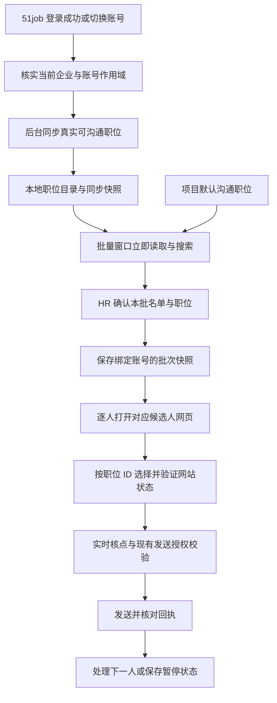

# 51job 可沟通职位本地缓存与批量打招呼方案

- 日期：2026-10-21。
- 代码核对基线：v1.8.39，提交 `1f8511f`。后续定位优先使用函数名。
- 交付：已确认需求、现状与根因分析、同步与发送设计、改动清单和验收标准。
- 本文属于设计方案。平台账号身份、全量分页和独立职位入口尚需登录实测；本文没有执行平台抓取或发送。
- 关联文档：[轻量初筛、初试核实与批量沟通整体方案](hr-first-interview-screening-outreach-plan.md)。本方案细化其中批量沟通的职位读取与选择方式，费用授权沿用当前系统。

## 1. 已确认的规则

| 决策 | 已确认行为 |
| --- | --- |
| 同步时机 | 首次登录或切换企业账号后，在后台同步；保留手动“刷新职位”。 |
| 本地显示 | 有缓存就立即显示职位和上次同步时间，不等待候选人网页或整份在线列表。 |
| 更新周期 | 距上次有效同步超过 24 小时，在后台刷新；刷新失败保留旧列表和同步状态。 |
| 同步范围 | 当前企业账号权限下“我的职位”和“公司职位”中实际可沟通的全部职位，遍历分页并标明完整性。 |
| 未验证的职位 | 已发布但未验证可沟通的职位单独标记，不自动用于发送。 |
| 项目默认职位 | 同一项目记住 HR 已确认的沟通职位，后续批次优先预选；确认页允许修改。 |
| 逐人执行 | 打开对应候选人网页，核验身份，按已确认职位 ID 选择该职位，实时核点，取得真实回执。 |
| 缓存失效 | 发送时职位失效，暂停并提示刷新/重新选择；不自动改用近似名称或第一条职位。 |
| 账号隔离 | 职位目录、项目默认关联和批次确认均绑定当前企业与账号作用域。 |
| 授权与交付范围 | 保留现有发送授权规则；本轮完成 MD 方案、代码改动分析、待实测项及验收要求。 |

**预期流程：登录后后台同步职位 → 本地保存 → 批量窗口即时展示并预选 → HR 确认本批 → 逐人打开网页并选择同一职位 → 实时核点发送 → 保存回执。**

“立即显示”针对本地职位列表。首次尚无缓存时仍需一次同步；实际候选人页面加载、平台选职、核点和发送回执仍依赖网站，不能以缓存代替。

## 2. 截图问题的实际原因

### 2.1 现在读取职位必须先打开候选人

当前调用链：

```text
打开批量确认弹窗
  → TopTenOutreachDialog.openBudget / loadJobs
  → ListOutreachCommunicationJobs
  → 找本批第一位可核验候选人
  → List51JobCommunicationJobs
  → 打开该候选人网页并等待沟通入口
  → 打开 Hi 聊职位选择窗口
  → 读取网站当前已加载的职位
```

关键事实：

- `TopTenOutreachDialog.vue / loadJobs` 每次打开都启动/连接浏览器并在线读取，失败时清空列表与选中值。
- `recruitment_outreach_budget.go / ListOutreachCommunicationJobs` 选择第一位可核验人选后直接返回结果；该人页面失败不会继续尝试其他读取上下文。
- `scripts/51job_conversation.js / waitCandidateReady` 最多进行两轮 12 秒等待。截图中的“候选人页面沟通入口未就绪”可能在真正读取职位之前发生。
- 已有聊天会话与新的 Hi 聊选职窗口走不同状态，现有列表读取还会拒绝部分已有沟通的人选。
- HR 确认本批时，`AuthorizeOutreachBudget` 又在线读取职位列表一次。

因此截图中的“无数据”不能直接解释为账号没有职位。实际可能是读取职位依赖的候选人页面没准备好。单给前端增加数组缓存，还会留下确认时第二次在线读取的阻塞。

### 2.2 现有职位列表与缓存缺口

| 位置 | 已有能力 | 缺口 |
| --- | --- | --- |
| `job_conversation.go / JobCommunicationOption` | ID、标题、公司名、地点等列表字段。 | 缺企业/账号作用域、公司 ID、同步时间、资格来源和完整性。 |
| `readCommunicationJobs` | 无关键词读 `myJobList / companJobList`，有关键词读 `jobList`，返回 `hasMore`。 | 没有自动遍历全量分页，不能把初页结果当全部职位。 |
| `listCommunicationJobs` | 观察页面触发的列表/搜索响应并等待组件。 | 当前没有独立于候选人详情的沟通职位同步入口。 |
| 发布职位相关脚本 | 填写、保存或发布新职位，读取操作结果。 | 没有已发布职位全量读取服务，也未据发布结果可靠保存平台职位 ID。 |
| `platform_job_mappings` | 能保存平台、账号、职位 ID 与项目映射。 | 部分调用传空账号；批次推荐还有跨项目、未按账号隔离的兜底查询。 |
| 51job 专用浏览器 | 平台级持久登录环境。 | 浏览器 profile 名称不能证明当前企业和操作员身份。 |

`sync_51job_posting_options.js` 等现有“同步”脚本同步的是发布选项字典；职能分类缓存也属于字典。这些不是企业实际可沟通职位目录。

### 2.3 缓存 ID 还不等于网站已选中

当前 `setCommunicationJobByID` 先在网站 Vue 组件的已加载列表中找到 **ID 与标题匹配**的记录，再使用其 `coid / companyName / jobID / title` 调用网站自己的选择逻辑。找不到会在线搜索后再次核对 ID。

所以本方案区分三件事：

1. 软件可以立刻显示并确认本地缓存中的职位。
2. 网站须真实接受该职位并形成正确选中状态。
3. 本次候选人的点数、实际发送与回执仍实时读取。

是否可以使用缓存完整记录调用平台现有选职入口、减少网站列表加载，需要登录实测。把字段写进页面或 Vue 状态，不能作为平台已接受该职位的证明。

## 3. 技术结构与服务边界



服务职责分开：

- **本地目录读取**：只查本地数据，打开弹窗时不启动浏览器、不访问网站。
- **后台同步**：读取平台真实职位及分页，保存同步进度与快照，不触发打招呼。
- **项目绑定**：保存 HR 已确认的默认职位，按企业/账号隔离。
- **批次确认**：确认固定名单、职位和现有授权，保存本地快照，不再在线重拉整份目录。
- **逐人发送**：访问当前候选人的网页，核实职位和实时报价，再执行已授权动作。

## 4. 职位从哪里同步

### 4.1 主数据必须来自真实沟通列表

首选来源为本账号平台实际提供的可选沟通职位列表，覆盖“我的职位”和“公司职位”。“已发布”只说明发布状态，不能直接等同为“此账号、此候选人当前可发起沟通”。

代码观察到页面会等待 `/jobj/list/get_combine_joblist` 和 `/jobj/list/v1/get_talent_joblist` 等路径。它们目前只是页面触发后被观察的实现细节，不是已经验证可独立调用的稳定接口。首阶段需确认真实参数、分页、权限和入口，再选择适配方式。

### 4.2 优先验证独立同步入口，保留过渡方式

| 路径 | 实施条件与方式 |
| --- | --- |
| 独立沟通职位入口 | 登录后核实是否有不依赖特定候选人的真实页面入口或可复用的已授权列表请求。确认可用后由专门同步任务遍历目录。 |
| 现有选职窗口过渡同步 | 若平台必须借助候选人详情才提供列表，将这一流程放到独立后台同步任务，不在批量确认弹窗中执行。使用身份明确、可打开选职窗口的读取上下文，失败时有限轮换，不绑定本批第一位候选人。 |
| 已发布职位目录 | 若后续新增读取，只作为发现和核对线索；未通过真实沟通列表或当前网页资格验证的职位显示“待核验”，不直接成为默认自动发送项。 |

过渡方案仍会遇到页面首次加载，它的收益是把读取提前并移出批量窗口。若没有可读取上下文，显示“职位尚未同步”，提供同步进度与原因，不以空列表伪装为企业没有职位。

后台任务允许打开必要的选职界面，但不能点击“发起 Hi 聊”、发送文案或产生由软件主动触发的沟通扣点。查看详情是否产生平台已读标记属于待实测行为，应在适配记录中说明。

### 4.3 遍历与完整性

- 分别遍历账号有权读取的“我的职位”和“公司职位”；重叠职位合并，保留其来源集合。
- 使用平台真实分页、游标或更多加载机制，保存进度；关键词搜索不能代替全量遍历。
- 明确区分 `not_started / syncing / complete / partial / failed`，记录各来源的页数、读取数及结束依据。
- 平台确认无权限的分组标“无权限/不适用”；只有状态已核实时才可作为本账号范围的完整同步。权限无法判断或某一页失败时记为部分完成。
- 列表卡住或游标重复时有限停止并记部分完成，不将“本页没变”直接当全量结束。
- 分页未结束时，已读取的有效职位可以显示，顶部标“同步未完成”；不能因未读到某职位就将旧记录删除或判下架。

一次同步完成时保存完整性快照。只有在当前账号范围完整扫描后，才可将旧目录中未再出现的职位标为“本轮未出现/需核对”；实际下架或不可用须有平台事实支持，不硬删除历史绑定。

## 5. 本地目录、作用域与更新规则

### 5.1 账号作用域必须先明确

建议作用域包含：`平台 + 企业稳定 ID + 操作员/子账号稳定 ID`，职位键再包含实际公司主体 ID 与平台职位 ID。公司名称、浏览器端口、profile 目录和空 `platform_account` 都不能代替已核实的身份。

当前代码尚未可靠获取这些身份。首阶段验证登录页面或授权页面中实际可读的身份字段；登录状态变化时产生新的会话代次 `session_generation`。

如果暂时无法核实稳定作用域：目录可在当前隔离会话下保存为待核对记录，跨重启或账号变化后不能自动恢复为可发送默认项。需先核实/明确确认当前来源，不能回退到全局空账号目录。

异步同步结果绑定启动时作用域和会话代次。切账号后旧任务即使返回，也不能覆盖新账号目录或改变当前选中值。批次执行前及恢复时再次验证账号一致性，发现切换即暂停原批次。

### 5.2 建议记录字段

| 记录 | 关键字段 |
| --- | --- |
| 职位条目 | 作用域、平台职位 ID、公司主体 ID/名称、标题、地点、原始发布状态、来源集合。 |
| 可沟通依据 | 是否来自真实沟通列表、观察时间、平台原始状态和读取上下文；单个候选人的不可用结论单独记录。 |
| 同步快照 | 同步任务 ID、作用域/会话代次、开始/结束时间、来源分页进度、数量、完整性、错误原因。 |
| 项目默认关联 | 项目 ID、作用域、平台职位/公司 ID、确认时标题、HR 确认时间和关联版本。 |
| 批次职位快照 | 批次 ID、作用域、HR 已确认的职位键/标题、引用的目录版本、确认时间、现有发送授权。 |

不要把某候选人无法使用该职位直接传播为整个账号的职位下架。目录“曾在平台可选列表出现”与“当前候选人已验证可用”分别保存。

### 5.3 更新与旧缓存

1. 登录成功或确认切换账号后排队后台同步。
2. 打开批量窗口始终先读当前作用域缓存；超过 24 小时排队刷新，不等待刷新完成再展示。
3. 提供“刷新职位”和同步时间/状态。手动刷新同样保留旧列表，失败时显示错误，选择仍须在发送前实时验证。
4. 发布、下线等操作有可靠成功结果时可标目录待更新并排队同步；当前发布流程未可靠返回职位 ID，不能凭职位标题直接写入可发送目录。
5. 新快照成功后合并更新；部分结果不能覆盖完整性事实或误删除未读取页的职位。

保留“最后一次成功完成全量同步时间”和“最近一次尝试时间”两个字段。失败尝试不能把旧目录变成新鲜目录。一次失败后退避，避免每次重绘弹窗都重启同步；同账号重复触发合并为一个任务。

后台同步与逐人发送共享浏览器会话时应排队协调：发送期间不能由同步任务改变当前候选人标签、职位选择或焦点。可在任务边界让出浏览器，不能打断已核点待确认的动作。

## 6. 软件内如何选择职位

### 6.1 批量窗口立即读本地

确认窗口打开后立即显示：

- 本批所属项目、当前企业账号、已选人数。
- 本地可沟通职位下拉与本地关键词搜索。
- 项目已确认的默认职位和平台职位 ID。
- 上次全量同步时间、当前刷新进度/部分完成提示。
- “刷新职位”操作；无缓存时显示首次同步指引。

不再把“连接浏览器 → 打开某位候选人 → 等列表”作为显示下拉的前置条件；候选人网页异常也不再清空本地职位目录。

### 6.2 默认职位匹配顺序

1. 同项目、同企业账号下 HR 已确认的默认沟通职位。
2. 当前批次仍有效且同作用域的已确认职位。
3. 在当前作用域内唯一同名的可沟通职位，仅作为预选建议。
4. 其他情况由 HR 从本地列表选一次。

同名不同 ID、不同公司主体、不同账号的职位分别显示，不能合并或取第一条。项目导入映射可作为有明确作用域的线索，但应与“默认沟通职位”职责分开；删除当前跨账号、跨项目的任意映射兜底。

HR 确认后保存项目默认关联及批次职位快照。后台刷新不得静默替换已确认批次的职位；同 ID 更名或公司主体发生不一致时，提示复核，再启用新的快照。

### 6.3 确认时移除第二次全量在线读取

改造 `AuthorizeOutreachBudget`：

- 根据当前账号、HR 选中的本地职位键、目录/关联版本及批次快照作结构校验。
- 未核验来源或作用域不一致不能成为自动发送职位。
- 保存本批确认与现有授权；不再为确认操作调用 `ListOutreachCommunicationJobs` 在线重读整份列表。
- 本次候选人的真实资格与点数检查放到 `PrepareOutreachItem`，不以缓存确认代替平台验证。

这样可以立即完成本地选择和批次确认；开始处理第一位人选后，界面分别显示“打开候选人”“选择职位”“读取点数”“等待回执”等进度。

## 7. 如何在对应候选人网页选择职位并打招呼

### 7.1 逐人执行步骤

```text
读取本批固定的账号与职位快照
  → 打开该候选人的已核验详情地址
  → 验证当前候选人身份与登录账号
  → 识别页面当前处于：入口/选职窗口/已有会话
  → 在真实网站选职入口按目标职位 ID 定位并选择
  → 核验网站内部选中状态、公司主体和页面显示一致
  → 实时读取本人的点数报价，校验现有授权
  → 执行已授权发送动作
  → 核验平台实际回执并落盘
  → 处理下一位或按明确原因暂停
```

同批共用的是职位身份，不是第一页候选人的聊天窗口、标签对象、报价或回执。每一人都必须重新核对当前页面身份。

### 7.2 网站选职适配策略

**优先路径：**保留实际 `coid` 等完整字段，验证平台现有选择入口是否允许按该记录选职；只有网站后续状态确认成功才视为选中。

**兼容路径：**如果平台必须先加载列表，使用目标标题触发搜索，再按职位 ID 与公司主体精确匹配后选择。即使需要这一轮在线加载，也只定位目标职位，不在软件弹窗重新收集整份目录。

两条路径均需验证 picker、外层选择状态和最终发送对象的一致性。不能只设置隐藏字段、跳过平台加载状态或使用缓存报价。缓存对象是否可直接复用为选职参数属于待实测条件，不作已实现承诺。

### 7.3 页面就绪与错误处理

修正页面状态识别：已打开的有效选职窗口也应被识别为可继续状态，避免因为它遮住 Hi 聊入口而反复等待。已有会话则进入对应的已联系/跟进逻辑，不无限寻找首次 Hi 聊入口。

| 情况 | 行为 |
| --- | --- |
| 单人网页未就绪，确定尚未发送 | 标记该人读取失败/待重试，保留目录；按队列策略处理其余人，登录等全局异常须暂停。 |
| 目标职位未出现在该人的可选范围 | 不替换职位，暂停本批并报告该人及目标职位，核对是账号、职位还是人选特定限制。 |
| 登录失效、账号切换、验证或平台限流 | 暂停，保留已处理进度和目录，提示所需处理。 |
| 平台实际职位与本批快照不一致 | 停在发送前，刷新/复核并重新确认。 |
| 核点失败或不符合现有授权 | 暂停相关发送，不以历史点数顶替。 |
| 已点击后回执或扣点不明 | 记录未决状态，先核查，不从打开页面步骤重放整次发送。 |

读取重试按阶段有限执行；不要只把等待时间整体拉长。日志分别记录候选人页面就绪、职位定位、选中验证和核点耗时，便于判断剩余瓶颈。

### 7.4 沿用现有授权、动作与回执

目前批量路径在首次平台 Hi 聊后还可能发送已确认的定制文案。缓存改造应保留本批已确认的动作清单，分别记录默认 Hi 聊与后续文案的完成状态，不因第二步失败而重复第一步。

当前脚本已有一次性报价、候选人/职位/点数复核和发送回执检查，可继续复用。缓存仅用于提前准备职位，不能充当发送授权或复用报价。

另外，当前界面写“不设点数上限”，前端实际传入单人 `100`、整批 `100000`，后台仍有预算校验。方案实施应记录并保留部署版本的实际授权值，界面措辞与实际行为保持一致；不得借缓存改造静默扩大授权。

## 8. 代码与持久化改动清单

| 文件/模块 | 改动方向 |
| --- | --- |
| 建议新增职位目录服务 | 本地查询、作用域隔离、后台同步调度、完整性快照、并发合并与刷新退避。 |
| 建议新增公司/账号身份适配 | 读取已登录的稳定身份、检测切换、会话代次校验；不能只用固定 profile。 |
| `recruitment_store.go` | 新增职位条目、同步任务/快照、项目默认沟通关联；批次授权补充账号与职位快照关系。 |
| `job_conversation.go` | `JobCommunicationOption` 补公司 ID 等字段；列表同步与单候选人发送职责分开。 |
| `scripts/51job_conversation.js` | 全量分页、保留源记录必要字段、分阶段就绪识别、精确选职与真实状态验证。 |
| `recruitment_outreach_budget.go` | 本地读取替代弹窗在线读取；确认不再全量重拉；逐人实时核点保持。 |
| `recruitment_outreach.go` | 默认职位按项目和账号查询，移除任意全局映射；快照及账号一致性校验，细化失败状态。 |
| `recruitment_import.go` | 现有导入映射与默认沟通关联分别维护；旧空账号映射需核对后才能用于新作用域。 |
| `TopTenOutreachDialog.vue` | 下拉立即读缓存、本地搜索、后台刷新提示、不清空有效旧值；确认与首人执行进度分开显示。 |
| 单人打招呼入口及职位管理 | 共用同一目录与作用域，提供同步状态和刷新入口，保持项目关联一致。 |
| Wails 绑定、类型及语言文件 | 新增目录/同步 API 和明确状态文案，区分“无职位”“未同步”“读取失败”“部分完成”。 |

建议服务接口职责：读取缓存目录、请求后台同步、查看同步进度、确认项目默认职位、确认本批快照。最终命名遵循仓库风格。`Prepare/ConfirmOutreachItem` 继续负责逐人真实页面与发送动作。

目录记录及成功快照先可靠落盘再报告更新完成；同步中断可恢复已知分页进度，平台游标失效时重扫并按稳定键幂等合并。历史职位和关联保留，避免同步失败损坏已确认批次。

## 9. 实施顺序及平台待实测项

### 9.1 实施顺序

| 阶段 | 工作 | 完成标准 |
| --- | --- | --- |
| A：登录后小样本核实 | 企业/账号身份、真实沟通列表来源、分页结束、公司字段、独立入口与选职方式。 | 明确哪些已验证、哪些只能用候选人上下文过渡。 |
| B：本地目录与后台同步 | 作用域、分页、快照、24 小时更新、失败保留与浏览器任务协调。 | 能准确报告本账号已同步内容、完整性和更新时间。 |
| C：批量选择解耦 | 缓存即时展示、默认项目关联、确认时移除在线全量重读。 | 有缓存时打开和确认均不依赖候选人页面。 |
| D：逐人选职与恢复 | 在真实候选人页精确选职，保留核点与回执，修正就绪状态及阶段错误。 | 网站选择与批次职位一致，失效可解释，未决动作不重复。 |
| E：联调与性能核对 | 单人/批量共用目录，旧映射迁移与异常场景验收。 | 通过第 10 章，报告本地耗时与平台耗时。 |

### 9.2 登录后必须核实

- 当前企业、操作员、公司主体的稳定字段与切换检测方式，子账号权限差异。
- 是否存在独立的真实沟通职位入口；若无，哪些候选人上下文可只读取得列表。
- “我的职位/公司职位”的实际分页、总数、终止依据与权限提示。
- 列表中职位 ID、公司 ID、标题与发布管理页面是否一致。
- 可沟通范围是否因人选而变化；已有沟通的人选如何进入正确状态。
- 缓存完整记录能否通过平台真实入口直接选职，或必须先在线搜索加载。
- 职位下架、更名、过期、权限变更后平台的实际反馈。
- 选择窗口已打开时页面就绪判断、点数更新、首条和后续文案回执的表现。

实测应形成字段与状态依据，不根据登录页、代码路径名称或已发布职位数量推断平台能力。

## 10. 验收标准

| 场景 | 必须满足 |
| --- | --- |
| 有有效本地目录，平台暂时无法加载 | 下拉仍立即显示缓存和同步时间，不因某候选人页面失败变成“无数据”。 |
| 首次没有缓存 | 显示“尚未同步”与实际同步进度；同步失败给具体阶段原因，不显示为账号无职位。 |
| 确认本批职位 | 保存本地固定快照，不触发第二次整份在线职位读取；真正发送前仍核验网站。 |
| 超过 24 小时、刷新失败 | 先显示旧缓存，后台刷新；失败保留原值，成功时间不会被失败尝试刷新。 |
| 多页、我的/公司职位重复 | 两类范围按实际权限遍历，稳定键去重，来源保留，完整性可解释。 |
| 只同步到一部分 | 已读结果可显示，明确部分完成；不能将未读职位判删除。 |
| 已发布但未验证可沟通 | 只作待核验线索，不自动成为本批发送职位。 |
| 同名不同 ID 或公司主体 | 单独显示、精确选择，不能取第一项或只比标题。 |
| 项目已确认默认职位 | 同作用域优先预选；新账号不继承旧账号的默认项。 |
| 同步期间切换账号、迟到响应 | 旧结果不会写到新账号，原批次停止自动发送并提示作用域变化。 |
| 后台同步与发送并存 | 不改动正在处理的候选人标签、职位选中状态、焦点及报价。 |
| 逐人打开网页 | 每人身份和已选职位都核对，不共享前一人的聊天目标或点数报价。 |
| 当前已打开选职弹窗 | 能识别为可继续状态，不因 Hi 聊入口被遮挡反复等待。 |
| 职位失效或平台选择与快照不符 | 停在发送前并提示复核，不用近似职位替代。 |
| Hi 聊已发、后续文案失败或回执不明 | 分动作保存，不重复发首条，不把未知当成功。 |
| 同步职位本身 | 不调用发送确认、不主动发消息、不产生由软件发起的沟通扣点；查看行为按实测记录。 |

性能验收建议：以本地 1,000 条职位为样本，弹窗读取与可选列表首屏展示 P95 目标不超过 300ms，并确认该路径的浏览器/网络调用数为 0；此为待实现后测量的目标。同步和逐人网站加载分别计时，不承诺平台固定响应时间。

## 11. 方案完成与后续交付

本方案把职位目录提前保存，将本地选择与真实发送解耦；发送时仍使用对应候选人网页和已确认的职位身份，保留实时核点、授权与回执。

后续开发交付包括：已登录小样本实测记录、目录及身份适配、迁移与绑定、缓存界面、逐人选职状态改造、关键异常测试，以及本地列表与实际平台耗时报告。文档中的已确认规则与待验证平台能力应分别验收。

## 12. 2026-10-21 首次同步失败修复记录

问题基线：v1.8.40，提交 `c4b943a`。该版本已加入缓存，但首次同步仍只选择一位候选人，经旧的 Hi 聊入口读取职位。实测人选已有沟通记录、页面显示“继续聊”，旧入口识别及职位读取路径无法取得目录，反复等待后报“候选人页面沟通入口未就绪”。

本轮修复：

- 优先通过已登录网页实际使用的请求适配器读取账号可沟通职位；认证信息保持在浏览器内，调用限制为两个职位列表读取操作。
- 将该路径接入 `SyncCommunicationJobs`，并兼容旧 `list_jobs` 调用，使账号目录读取不依赖候选人的聊天入口。
- 目录读取维持后台页面活动，完成后清理临时状态；正常同步不导航到人选页或点击聊天入口。
- 平台组件确实不可用时才尝试有限、去重的候选人上下文；一个上下文失败不反复绑定同一人。
- 遍历目录分页，遇到重复页或分页失败时保留结果并标部分完成。
- 空缓存时前端直接使用新的同步服务；失败保留旧数据、展示真实失败状态，不更新最后成功时间或误报成功。

验证结果：

| 验证 | 结果 |
| --- | --- |
| 真实已登录账号，只读调用平台目录 | 取得 16 个可沟通职位，平台返回无后续分页。 |
| 原有候选人上下文的旧 `list_jobs` 路径 | 返回同一批 16 个职位，单次实测约 671ms，不再等待该人 Hi 聊入口；不是平台响应时间承诺。 |
| `node --test scripts/51job_conversation.test.js` | 29 项通过，覆盖独立目录读取、旧调用兼容、后台活动、分页、身份/核点和发送回执保护。 |
| 相关 Go 回归 | 无候选人也可同步、候选人后备轮换、部分目录、失败保留及缓存授权均通过；缓存写入使用隔离测试数据库。 |
| Windows 构建 | 生成 `build/bin/TalentLens-job-sync-fix.exe`，包含前端和配套脚本。 |

实际调用的软件进程需使用修复版后，再点击同步将目录保存到正式本地数据库。网站请求适配器依赖当前平台实现，后续结构变化需按错误状态维护；本记录不代表方案中的其他设计已全部实现。

建议提交说明：`fix(51job): read communication jobs from the account catalog instead of a candidate chat entry`。
