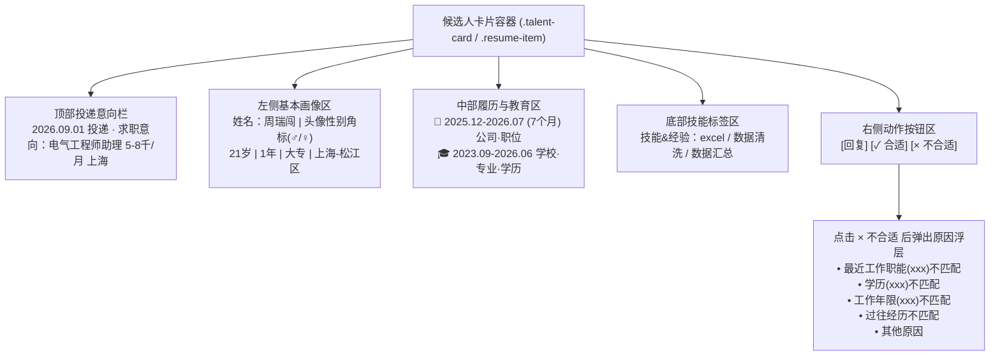
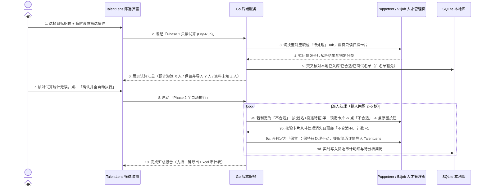

# 前程无忧（51job）「人才管理」自动筛选与不合适淘汰技术方案

> [!IMPORTANT]
> **核心定位**：针对前程无忧企业端「人才管理（`https://ehire.51job.com/Revision/talent/management`）」页面下的海量「待处理」主动投递/推荐简历，支持 HR 在弹窗中临时配置硬性筛选条件，通过**「先只读试算（Dry-Run） $\to$ 确认后全自动逐人点击不合适并勾选原因 $\to$ 合格人选自动导入 TalentLens 待分析」**的闭环，实现零误伤、可审计、防风控的自动化初筛。

---

## 一、业务痛点与核心原则

### 1.1 业务痛点
1. **待处理投递积压严重**：如截图中单个岗位「AI赋能开发程序员」下积压了 **130 份** 待处理简历，大量投递者在年龄、学历、现居地、求职意向城市、期望薪资或毕业时间（在校生）上明显不符合岗位要求。
2. **平台手工操作繁琐**：在 51job 页面上，每淘汰一人都需要「人工扫视卡片 $\to$ 点击右侧 `× 不合适` $\to$ 在弹出的原因框中选择具体原因」，处理 130 人需重复点击近 300 次。

### 1.2 核心设计原则（已对齐确认）
| 决策项 | 确认规则 |
| :--- | :--- |
| **自动化边界** | **只自动点「不合适」，绝不自动点「合适」**。硬性条件全部符合的候选人保留在 51job「待处理」，并自动导入 TalentLens 对应职位作为待分析简历，交由 AI 深度评估与 HR 人工决定是否合适。 |
| **未知不误筛** | 只有卡片上**明确解析到且不满足**的字段才触发「不合适」；卡片未披露或无法解析的字段一律视为「资料未知」，保留在「待处理」并在软件中标记原因，绝不盲目淘汰。 |
| **条件配置方式** | 在 TalentLens「人才管理自动筛选」弹窗中**每次临时设置**，不写死到职位配置，灵活应对不同批次的筛选松紧度。 |
| **两阶段触发** | 手动点击启动后，先执行 **Phase 1 只读试算（Dry-Run）**，汇总展示「预计标不合适 X 人 / 保留并导入 Y 人 / 资料未知 Z 人」；HR 点击一次确认后进入 **Phase 2 全自动连续执行**，中途无需逐人确认。 |
| **合规门禁** | 年龄、性别筛选默认关闭；开启时显示合规提示，需勾选「已确认岗位有合法特殊理由」方可启动；命中年龄/性别时在 51job 对外一律勾选「其他原因」，仅在本地审计日志记录真实命中项。 |

---

## 二、51job「人才管理」页面 DOM 结构与字段提取映射

对照 51job 企业端「人才管理」页面结构（见截图），单张候选人卡片包含以下可提取区域：



### 2.1 卡片结构化字段提取规则

| 字段名称 | 页面原文示例 | 解析正则表达式 / 提取策略 | 缺失时处理 |
| :--- | :--- | :--- | :--- |
| **候选人姓名** | `周瑞闯`、`申佳怡` | 卡片姓名节点文本，去除标签后缀（如 `精选`、`已看`） | 缺失则跳过该卡片并告警 |
| **性别** | 头像右下角蓝/粉角标（`♂`/`♀`、SVG class `icon-male`/`icon-female`）或称谓 `先生`/`女士` | 优先检测头像角标 DOM 类名/颜色与性别图标，其次匹配 `先生`/`女士` | `unknown`（未知不淘汰） |
| **年龄** | `21岁` | `/(\d{2})\s*岁/` 提取整数 `21` | `unknown` |
| **工作年限** | `1年`、`在校生`、`应届生`、`无工作经验` | 若含 `在校生\|应届\|无经验` 记为 `0` 年（并标记 `isStudentOrFresh`）；否则 `/(\d+(?:\.\d+)?)\s*年/` | `unknown` |
| **最高学历** | 基本画像行 `大专`、`本科` 或教育行末尾 `·本科` | 映射等级：`中专/高中=1, 大专=2, 本科=3, 硕士=4, 博士=5`，取卡片最高学历 | `unknown` |
| **现居地** | `上海-松江区`、`北京` | 基本画像行第 4 段（年龄\|年限\|学历\|现居地），提取城市主名与区名 | `unknown` |
| **求职意向城市** | `求职意向：电气工程师助理 5-8千/月 上海` | 顶部投递行提取末尾城市名 | `unknown` |
| **期望月薪** | `5-8千/月`、`1-1.5万/月`、`面议` | 统一换算为以 `K/月` 为单位的区间 `[minK, maxK]`（如 `1-1.5万/月` $\to$ `[10, 15]`） | `面议` 或缺失记为 `unknown` |
| **毕业时间（在校生判定）** | `🎓 2023.09-2026.06` | 提取教育行结束年月 `YYYY.MM`，若晚于当前任务日期（或含 `至今`）则判定为 `在读/未毕业` | `unknown` |
| **所学专业** | `张家口学院 · 数字媒体技术（电子与信息大类） · 本科` | 提取教育行 `学校 · 专业 · 学历` 中间段文本 | `unknown` |

---

## 三、9 项筛选维度判定逻辑与「不合适原因」映射表

### 3.1 判定规则（任一启用的条件明确不符 $\to$ 判定为「不合适」）

1. **最低学历**：启用时，若 `card.eduRank != unknown` 且 `card.eduRank < filter.minEduRank` $\to$ **不合适（学历不符）**。
2. **工作年限下限**：启用时，若 `card.workYears != unknown` 且 `card.workYears < filter.minWorkYears` $\to$ **不合适（工作年限不符）**。
3. **排除在校生/未毕业**：启用时，若卡片明确标有 `在校生` 或教育经历结束时间 `> 当前年月` $\to$ **不合适（工作年限/在校生不符）**。
4. **现居地限制**：启用时（支持填多个允许城市，如 `上海, 苏州`），若 `card.residence != unknown` 且不包含任一允许城市关键词 $\to$ **不合适（居住地不符）**。
5. **求职意向城市限制**：启用时，若 `card.intentCity != unknown` 且不包含任一允许城市关键词 $\to$ **不合适（意向城市不符）**。
6. **专业关键词限制**：启用时（输入允许的专业关键词列表，如 `计算机, 软件, 数字媒体, 电子, 自动化`），若 `card.major != unknown` 且不包含任一允许关键词 $\to$ **不合适（专业不符）**。
7. **期望月薪上限**：启用时（如上限 `15K`），若 `card.salaryMinK != unknown` 且候选人期望月薪**下限** `card.salaryMinK > filter.maxSalaryK`（候选人最低期望都高于岗位上限） $\to$ **不合适（期望薪资超上限）**。
8. **年龄区间**（合规受控项，默认关闭）：启用时，若 `card.age != unknown` 且不在 `[minAge, maxAge]` 区间内 $\to$ **不合适（年龄不符）**。
9. **性别限制**（合规受控项，默认关闭）：启用时，若 `card.gender != unknown` 且 `card.gender != filter.gender` $\to$ **不合适（性别不符）**。

### 3.2 51job「选择原因」弹窗按钮智能映射优先级

由于 51job 弹出的原因按钮文字会动态携带候选人属性（例如截图中：`学历(大专)不匹配`、`工作年限(在校生)不匹配`、`最近工作职能(数据标注师)不匹配`），脚本采用**前缀/关键词模糊匹配 + 兜底回退**策略：

| 命中的淘汰条件（按优先级排序） | 优先匹配的 51job 弹窗按钮正则 | 若当前弹窗无对应按钮时的兜底选择 |
| :--- | :--- | :--- |
| **学历不符** | `/^学历.*不匹配/` | `其他原因` |
| **工作年限不符 / 在校生排除** | `/^工作年限.*不匹配/` | `其他原因` |
| **专业关键词不符** | `/^专业.*不匹配/` | `其他原因` |
| **现居地 / 求职意向城市不符** | `/^(?:居住地\|现居地\|地点\|城市).*不匹配/` | `其他原因` |
| **最近工作职能不符**（预留映射） | `/^最近工作职能.*不匹配/` | `其他原因` |
| **过往经历不符**（预留映射） | `/^过往经历.*不匹配/` | `其他原因` |
| **期望月薪超上限 / 年龄 / 性别** | 直接匹配 `/^其他原因$/` | `其他原因` |

> [!TIP]
> 当同一名候选人同时命中多项不符条件（例如既是大专学历、又是异地）时，系统优先按可映射到 51job 具体标签的条件（`学历` $\to$ `工作年限` $\to$ `专业` $\to$ `居住地` $\to$ `其他原因`）点击对应按钮，同时在 TalentLens 本地审计记录中完整保存**所有命中的不符项**。

---

## 四、两阶段执行流程与安全机制设计



### 4.1 六大防误伤与防风控安全护栏

1. **单职位与「待处理」Tab 强校验**：
   - 脚本执行前，先核对顶部当前激活的职位名称（如 `AI赋能开发程序员`）是否与 HR 选定的职位严格一致，并确保二级 Tab 处于 `待处理` 状态；若不一致且无法自动切到目标职位，立即中止并提示。
2. **TalentLens 本地白名单豁免**：
   - 若某候选人此前已在 TalentLens 中被标记为 `合适`、`面试`、`Offer` 或 HR 手动保护状态，即使命中本次临时条件也自动跳过，绝不在 51job 点不合适。
3. **唯一卡片定位与「点后核验」闭环**：
   - 点击 `× 不合适` 前，记录当前页面「待处理·M」与「不合适·N」的数字，并通过 `姓名 + 年龄/学历/投递意向行文本指纹` 唯一锁定卡片。
   - 点击原因按钮后，等待最多 3 秒验证该卡片从 DOM 移除或「不合适」计数变为 `N + 1`。若未变化或弹出未知对话框，**立即暂停任务并上报，绝不盲目二次点击**。
4. **当前页原地消化与安全翻页**：
   - 注意：在 51job「待处理」列表中，每点掉一个「不合适」，该卡片会从当前列表移除，下方卡片会自动上移补位！
   - 因此脚本在当前页采取**「扫描当前页 $\to$ 逐个点掉本页所有不合适卡片 $\to$ 抓取本页保留候选人 $\to$ 再翻下一页」**的策略，防止边翻页边删除导致漏页或错位。
5. **正态分布拟人停顿与单次上限**：
   - 每次点击「不合适」间隔采用 Box-Muller 正态分布随机停顿 `2000ms ~ 5000ms`，单次任务默认上限 **200 人**，全程检测滑动验证码/风控弹窗，一旦触发立即安全挂起。
6. **随时可停与断点保护**：
   - 支持 HR 随时点击「停止任务」，脚本在完成当前单个候选人的原因选择后立即停机，已记录的审计日志和已导入简历完整保留。

---

## 五、模块改造与文件落点清单

| 层级 | 文件路径 | 新增 / 修改内容 |
| :--- | :--- | :--- |
| **1. 自动化脚本层** | `scripts/51job_talent_management_filter.js`（新增） | 连接 `9503` 端口已登录的 51job 浏览器，支持 `--mode dry_run`（只读试算）与 `--mode execute`（全自动点不合适 + 保留人选提取），输出 JSON Lines 实时进度。 |
| **2. 单元测试层** | `scripts/51job_talent_management_filter.test.js`（新增） | 覆盖卡片文本解析、9 项筛选规则判定、未知字段不误筛、原因按钮动态匹配、计数校验与异常熔断测试。 |
| **3. Go 存储与服务层** | `recruitment_store.go` / `recruitment_talent_filter.go`（新增） | 新增 `talent_management_filter_runs` 与 `talent_management_filter_items` 两张 SQLite 表，提供 `Preview51JobTalentManagementFilter`（试算）、`Run51JobTalentManagementFilter`（执行）、`Stop51JobTalentManagementFilter`（停止）、`Export51JobTalentFilterReport`（导出 Excel）。 |
| **4. 前端交互层** | `frontend/src/components/TalentManagementFilterDialog.vue`（新增） | 临时筛选条件配置弹窗（含 9 项筛选开关、年龄/性别合规勾选框、Phase 1 试算结果预览卡片、Phase 2 实时进度条与审计导出按钮），挂载于职位管理/人才库入口。 |

---

## 六、导师深度拆解：规则引擎中的「三值逻辑（Three-Valued Logic）」与 DOM 列表原地删除游标问题

为了让你不仅能用好这个功能，还能彻底掌握背后的工业级设计精髓，我们按四步拆解本方案中最核心的两个底层技术点：

### 1. 白话本质与生活类比
- **三值逻辑（Three-Valued Logic：`True / False / Unknown`）**：
  就像机场安检核对旅客证件：普通非黑即白的逻辑是“只要没看到良民证就当坏人抓起来”（二值逻辑）；而我们的“未知不误筛”是**三值逻辑**——明确看到违禁品才拦截（`False` $\to$ 不合适），明确检查合格才放行（`True` $\to$ 符合），如果行李 X 光机某处看不清（`Unknown` $\to$ 资料未披露），绝不直接扔进垃圾桶，而是转交人工开包台（保留在待处理并标注“资料未知”）。
- **原地删除游标偏移（In-Place Mutation Cursor Shift）**：
  想象一排站着报数的队伍（第 1、2、3、4 号候选人）。如果你把第 2 号请出队伍，原来的第 3 号就会自动往前迈一步变成新的“第 2 号”。如果你闭着眼睛按序号“点完第 2 号紧接着点第 3 号”，新的第 2 号（原第 3 号）就被你漏掉了，甚至会点错人！

### 2. 为什么这样做（解决什么痛点）
1. 如果用普通布尔逻辑（`card.edu === '本科'`），一旦候选人卡片上没写学历（`card.edu === ''`），表达式求值为 `false`，就会把一位可能非常优秀的博士/硕士候选人直接淘汰，且 51job 点了「不合适」不可撤销。
2. 如果按 DOM 下标 `cards[0], cards[1], cards[2]` 循环点击「不合适」，因为 51job 前端框架（Vue/ElementUI）会在点击原因后立刻从数组里 `splice` 移除该卡片，下标后面的所有卡片都会前移，导致严重的**跳项漏判**或**点错下一位候选人**。

### 3. 底层工作机制与源码逻辑
1. **三值判定器（Tri-State Evaluator）**：
   每个维度的规则函数不返回 `boolean`，而是返回枚举值 `'PASS' | 'FAIL' | 'UNKNOWN'`：
   ```js
   function checkMinEducation(cardEduRank, requiredMinRank) {
     if (!requiredMinRank) return 'PASS';          // 未启用该规则
     if (!cardEduRank || cardEduRank <= 0) return 'UNKNOWN'; // 卡片未披露 -> 未知不误筛
     return cardEduRank >= requiredMinRank ? 'PASS' : 'FAIL';
   }
   ```
   汇总判定时：
   - 只要有任意一项返回 `'FAIL'` $\to$ 最终判定为 `'UNFIT'`（触发自动点击不合适）；
   - 没有 `'FAIL'` 但存在 `'UNKNOWN'` $\to$ 最终判定为 `'KEEP_UNKNOWN'`（保留在待处理，导入时打上「某字段未披露」提示）；
   - 全部为 `'PASS'` $\to$ 最终判定为 `'KEEP_MATCHED'`（保留在待处理并导入 TalentLens 待 AI 初筛）。
2. **指纹锚定法消除游标偏移**：
   在执行删除时，绝不使用固定数字下标 `index`，而是每次操作前用候选人的唯一身份指纹（`candidateKey = 姓名 + 投递职位 + 教育/经历摘要`）在最新 DOM 树中实时 `find` 对应的卡片节点：
   - 点掉一位「不合适」并等待该节点从 DOM 树卸载（Detach）后，重新扫描当前视口剩余卡片；
   - 直到当前页所有命中 `'UNFIT'` 的指纹卡片全部清零，才点击底部分页器进入下一页。

### 4. 举一反三与避坑指南
- **坑点 1：薪资区间对比时把“期望上限”与“岗位上限”搞反**
  - *现象*：候选人写期望薪资 `10-15K`，HR 设期望月薪上限 `12K`。如果按候选人的最高期望 `15K > 12K` 淘汰，其实候选人 `10-12K` 是愿意谈的，就会误杀。
  - *最佳实践*：只有当**候选人的最低期望薪资 `minSalary` 都高于 HR 设定的上限 `maxAllowed`**（例如候选人期望 `15-20K`，而岗位上限 `12K`，双方价格区间完全无交集）时，才判定为不合适。
- **坑点 2：原因浮层残留在页面遮挡后续点击**
  - *现象*：如果某次点击「不合适」后弹出了「选择原因」浮层，但原因按钮因网络卡顿没点上，浮层一直停留在页面上，会导致下一个候选人的点击被浮层挡住。
  - *最佳实践*：每次点击原因后必须验证浮层已关闭（`display: none` 或从 DOM 移除）；若异常中止，先触发右上角关闭按钮 `.close / Escape` 清理现场再安全暂停。
