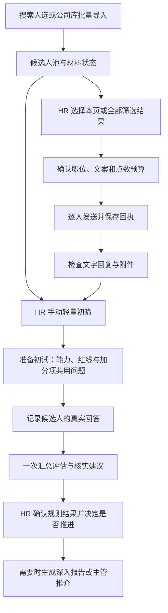
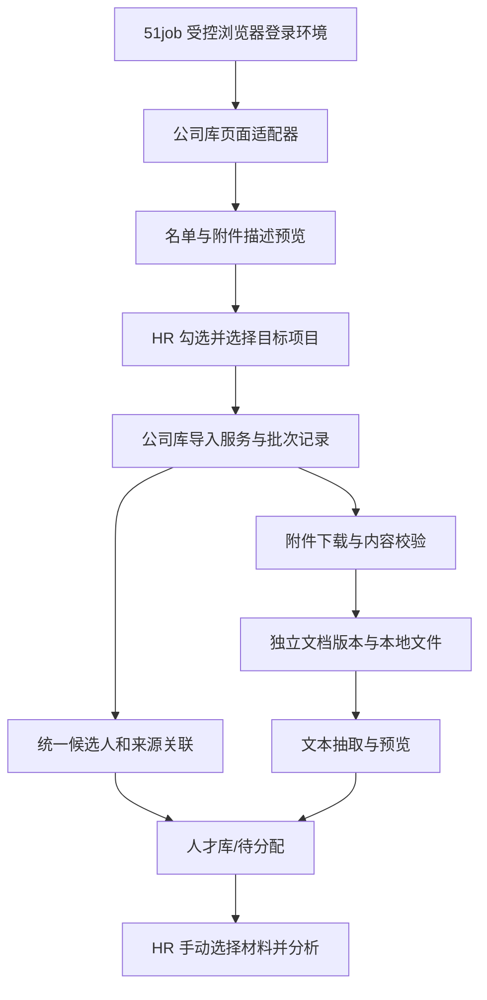

# TalentLens 轻量初筛、初试核实与批量沟通优化方案

- 日期：2026-10-20。
- 现状核对：v1.8.31，提交 `c9ce459`。代码定位以函数名为主。
- 交付范围：需求方案、当前实现差距、改动设计与验收标准；本文不代表功能已经实现，也不执行平台发送或公司库导入。
- 方案目标：让 HR 快速掌握“值得了解什么、初试核实什么、下一步联系谁”，把深入分析放到真正需要的阶段。
- 已确认的公司人才库接入方案完整并入第 8 章；有关登录后页面、附件权限及身份映射的实测仍待完成。

阅读顺序：第 1 章看整体流程，第 5 章看初试问题，第 6 章看 token 控制，第 7 章看全部人选打招呼，第 8 章看公司人才库接入，第 9–10 章看改动范围与实施验收。

## 1. 建议采用的整体方案

**抓取/导入 → 待分析人选池 → 可直接批量打招呼 → 对有意向或 HR 选中的人轻量初筛 → 准备初试 → 用真实回答核实红线和加分项 → HR 决定是否推进。**

轻量初筛也可以在打招呼前手动执行，两条路径并存。是否已经生成测评、分数高低和是否达到正式排名覆盖率，不作为发起沟通的统一前置条件。

| 事项 | 本方案建议 |
| --- | --- |
| 初步分析 | 默认生成简短摘要、固定岗位维度的证据、红线/加分项待核实线索；首次分析直接完成统一雷达所需数据。 |
| 初试问题 | 将红线、加分项和岗位能力映射到同一套问题；一问可以核实多项，减少重复询问。 |
| 分析成本 | 共享岗位画像和题目骨架，按需生成个性问题；不为所有简历提前生成长报告、长参考答案和 AI 招呼语。 |
| 批量沟通 | 支持本页全选、跨页选择当前筛选结果全部人选；确认本批职位、文案模式和点数预算后逐人发送。 |
| 广泛触达 | 未分析、资料不全或红线待核实的人选可被 HR 纳入沟通；已确认不符合硬性条件等人选默认排除并说明原因。 |
| 公司人才库 | HR 筛选后勾选候选人及附件，导入到目标项目或待分配，保留附件版本，分析仍手动触发。 |
| 分数稳定 | 沿用固定岗位指标、可定位证据和程序计算；相同输入复用结果，不通过限制分数涨跌来掩盖变化。 |

本方案保留既有决定：寻才只抓取、人数不足继续定时补抓；不重新引入单独的经历雷达重核按钮或“重新分析”入口。失败重试与 AI 复核差异继续保留。主动投递等其他已有导入流程是否自动触发分析，维持各自当前触发规则；一旦触发，使用新的轻量分析服务。

文中的默认题量、token 预算和试验目标是本次建议，需实施后校准；它们不是已实测的性能或平台限额。

## 2. 当前实现及改动原因

| 当前实现 | 对 HR 和成本的影响 | 改动方向 |
| --- | --- | --- |
| `app.go / buildAnalysisPrompt` 同时要求维度分析、5 道带参考答案的问题、推介卡、履历风险检查和多项长文结论。 | 所有人都提前承担深入报告成本，初筛等待变长，输出结构也更容易出错。 | 拆成轻量初筛、初试准备、初试评估及按需报告。 |
| `resume_competencies.go / completeInitialCompetencies` 在首轮缺项时可能再调用模型补能力。 | 一份简历并不一定只有一次请求；失败时现有文案还可能把补全标为完成。 | 首轮只输出一套固定维度；局部缺项按实际状态保存，必要时只修复缺项。 |
| `app.go / AnalyzeResume` 仍有首次分数附近 ±5 的重分析限幅。 | 数字看似稳定，却不能证明证据、维度和结论稳定。 | 落实岗位版本、输入哈希、证据复用和复核差异；移除限幅。 |
| `interview.go / StartInterview` 依赖已生成 `InterviewQA`；追加 2 道统一题、已有题目及未知红线题，没有对应的加分项题目生成链路。 | 不先生成整份分析就不能开始；题目容易重复，红线与加分项没有融入对话。 | 由固定岗位题纲和待核实事项组装初试，可先使用已有材料和模板。 |
| `InterviewTurn` 只有一个 `RuleID`；`scoreInterviewAbility` 排除带规则 ID 的整道题。 | 同一题同时考察能力和红线时，能力证据可能被一并排除。 | 改为题目与维度、红线、加分项的多对多关联，分别保存能力证据和核实结论。 |
| `evaluateInterviewTurn` 每题调用模型，追问回答可能再调用；`CompleteInterview` 再做一次总结。 | 一次初试可能有多次请求，还会重复发送上下文。 | 回答先本地保存，默认结束时统一评估；只有 HR 主动要求时才即时生成追问。 |
| `recruitment_outreach.go / PreviewTopTenOutreach` 从已分析排名中选人，最多 10 人；`TopTenOutreachDialog.vue` 的全选只覆盖这批人。 | 当前“全选”不能覆盖整个筛选结果，待分析的人无法走同一批量入口。 | 新建独立的批量选择和预览服务，排名前十保留为可选快捷范围。 |
| `generateAIOutreachGreeting` 在配置模型时为人选生成 AI 定制招呼语，提示词及兜底文案存在固定公司名和过强的契合表达。 | 预览就可能产生多次 AI 调用；简略材料可能被写成过度肯定的推荐。 | 默认平台招呼或零 AI 模板，公司信息来自配置，个性化 AI 文案按需。 |
| `TopTenOutreachDialog.vue / runQueuedOutreach` 由前端循环执行；单人核点或发送非成功通常直接中断整批。 | 一个局部问题会拦住后续人选，窗口状态也影响长任务恢复。 | 后端持久队列，区分单人跳过、全批暂停与回执待核对。 |
| `recruitment_outreach_budget.go` 已有真实职位读取、匹配建议、预算授权及逐人核点基础。 | 不是从零重写发送；现有保护和回执机制有复用价值。 | 保留并扩展到全量选择、后台队列和统一任务状态。 |
| 当前没有 `talent/store` 公司库专用适配器，投递导入和聊天附件流程各有自己的来源假设。 | 不能直接套用投递申请 ID 或聊天附件 DOM。 | 新增公司库适配层和独立附件版本，详见第 8 章。 |
| `ChatResponse` 未保存 token usage，通用 AI 调用还有传输重试、格式重试及特定模型输出上限调整。 | 目前不能准确给出每份简历实际 token、重试成本和节省比例。 | 先记录按阶段、按尝试的 usage，再用相同样本验证。 |

上述是代码路径分析。某一份简历的实际失败原因仍应从该次任务错误定位，不能把所有失败都归因于 token 或 JSON。列表读取、附件提取、模型超时、格式校验和平台发送应分别记录。

## 3. 面向 HR 的工作流程



### 3.1 候选人池

- 卡片突出姓名/称呼、最近岗位和公司、技能、材料完整度、联系状态及初筛状态。
- 岗位证据分在有有效评估时显示；待分析显示“待分析”，不得伪造 0 分。
- 分析、联系、附件、初试是独立状态。例如“待分析 · 已打招呼 · 有附件”，不能用一个“已完成”代表所有环节。
- 主要操作为“查看测评”“打招呼”；多选后显示“批量打招呼”“批量初筛”。
- “检查回复”读取真实文字回复及附件；“索要简历”保留为 HR 主动动作。已有有效附件时提示可直接查看，避免重复索要。

### 3.2 初筛页

默认显示一段短摘要、技能证据雷达、红线/加分项待核实清单以及“准备初试”。深入报告、主管推介和全文翻译放在按需操作中。

材料太短时展示“依据不足，建议先沟通/补充简历”，保留可用事实。未生成的深入模块标为“按需生成”，不能显示成分析失败，也不能用空模块冒充已完成。

### 3.3 初试页

左侧按对话顺序显示问题，右侧显示本题覆盖的能力维度、红线和加分项。HR 不需要切换到另外一张评分卡逐项重复核对。

HR 保存回答无需等待 AI；结束后点击“生成初试评估”，获得证据建议及待确认项。所有原始回答先可靠落盘，模型失败不影响继续记录或人工判断。

## 4. 轻量初筛应输出什么

### 4.1 输入按岗位和候选人分别准备

**岗位侧共享一次：**岗位标题、精简职责、固定版本的技能指标和锚点、HR 启用的红线与加分项、统一问题骨架。HR 未填技能时按已有雷达方案推导并固定岗位版本；只有名称时用职业模板并标注 AI 推定，不自动生成淘汰红线。

**候选人侧逐人准备：**保留材料清单和完整原文，按经历、项目、技能、教育等分区去重，生成带文档 ID 和片段 ID 的证据输入。先使用本地规则定位相关内容；模型负责理解职责与成果，不能把关键词出现次数当作能力分。

不能只取原文开头若干字符：工作经历可能在后面。超预算时优先保留与岗位维度和规则相关的各段；记录哪些文档/片段未送入模型。遗漏部分可能包含关键证据时，显示“材料处理不完整”，暂不正式排名。

### 4.2 最小结果

| 内容 | 初筛保留范围 |
| --- | --- |
| 基本事实 | 姓名/称呼、最近公司和岗位、原文明确的经历/技能；能本地解析的字段不重复让模型改写。 |
| 岗位维度 | 与固定画像一一对应的证据状态、支持等级建议、片段引用和必要缺口。 |
| 红线和加分项 | 每项记录“原文支持/存在冲突/未提及”线索与引用，均为核实建议，不冒充 HR 已确认结论。 |
| 初筛摘要 | 建议 2–3 句，说明相关经历、主要待核实点和下一步。资料不足不强凑优缺点条数。 |
| 初试待核实事项 | 规则 ID、维度 ID、缺少什么事实；无需此时展开成 5 份长参考答案。 |
| 可选深入模块 | 履历风险长报告、主管推介、完整个性化题目和定制招呼语均按需生成。 |

首次轻量分析即产出统一技能雷达需要的证据，前后端都使用同一份维度结果。旧 `CoreCriterionChecks`、`ExperienceCompetencies` 如需兼容，应由同一规范结果生成投影，不能分别发起两轮完整评估。

建议新响应只表达事实与建议：`dimensions[]`、`criterion_signals[]`、`interview_gaps[]`、`brief_summary`、`source_refs[]`。岗位 ID、版本、材料哈希等由应用生成/校验；避免让模型重复长篇返回输入元数据。

### 4.3 评分与稳定性

沿用[统一雷达分析契约](../skills/job-radar-standardizer/references/analysis-contract.md)：

1. 固定岗位维度优先 5–6 个、最多 8 个，默认等权，同岗位版本共用。
2. 未知/冲突与真实低等级分开，模型提供证据建议，程序验证引用并计算分数。
3. **有效证据权重覆盖至少 80% 才按已知维度生成正式岗位证据分并排名**；不足进入待核实组，展示覆盖率和暂评区间。
4. 排名限定相同画像与评分版本；已确认红线和加分项单独展示，不暗中修改雷达能力分。
5. 相同材料、岗位、规则和分析策略版本复用结果。AI 复核先出差异草稿，HR 确认再激活；不保留 ±5 限幅。
6. 保持 v1.8.31 的单一评分概念，不重新引入“综合参考匹配度”。初筛与初试可以有不同证据阶段快照，但要明确来源，不能混为同一时刻的分数。

轻量初筛减少不必要的生成内容，不降低引用、未知状态和固定标尺的要求。正式排序尚未完成这些规范时，应标为旧口径结果，不能仅换界面名称就宣称已经规范化。

## 5. 将红线和加分项融入初试提问

### 5.1 从“追加核对题”改为“问题覆盖规则”

同一项目案例可以同时考察能力、核实一条红线并验证一条加分项。问题与核实目标采用多对多关系，规则 ID 稳定，不以可编辑的题目文本充当关联键。

```json
{
  "question_id": "q-test-project-01",
  "question_version": 1,
  "question": "请选一个你负责过的版本，说明你如何设计测试覆盖、安排执行、跟踪缺陷并确认发布；你独立负责哪些部分？",
  "dimension_ids": ["test-process", "test-design"],
  "verification_targets": [
    {"rule_id": "rl-independent-testing", "kind": "redline", "rule_version": 2},
    {"rule_id": "bn-automation-delivery", "kind": "bonus", "rule_version": 1}
  ],
  "follow_up_hints": [
    "没有说明本人职责时，追问独立负责范围与团队分工。",
    "涉及自动化时，追问实际脚本、流水线接入、使用范围和结果。"
  ]
}
```

这是接口形态示例，不是预置给所有岗位的硬性标准；规则必须来自该项目真实启用的配置。题目中的加分项在主问未覆盖时由条件追问补足，不能只做 ID 关联而没有实际提问。

### 5.2 问题规划顺序

1. 读取本岗位版本的统一题纲与规则，不逐人重复生成通用题。
2. 读取本人的原文线索和已存在的 HR 核实记录；已确认事项按有效版本复用，必要时提示复查依据。
3. 优先安排未核实红线，其次安排核心能力缺口和加分项；把能由同一真实项目回答的目标合并。
4. 每条待核实红线必须有问题、有效的既有核实依据，或明确的“待核实”记录。加分项同样显示“本次覆盖/待补充/不适用”，不能悄悄遗漏。
5. 沟通协作、动机和到岗安排等 HR 常规问题按需要保留，不再机械固定“3 道软能力 + 2 道技术题”。技术追问聚焦职责、方法和证据，复杂实现细节交给后续专业面试。
6. 默认建议 5–8 个主问题、约 15–20 分钟，优先合并；规则较多时提示预计时长，允许拆为下一轮，不用题数上限隐藏未核实红线。

### 5.3 HR 可直接使用的示例

以下以软件测试工程师为例，具体红线和加分项是否启用由岗位配置决定。

| 主问题/条件追问 | 同时覆盖 | HR 应记录的事实 |
| --- | --- | --- |
| 请介绍最近一个完整测试版本：本人负责什么，如何形成测试计划、用例、缺陷闭环和发布结论？ | 能力：流程与用例；红线：是否有独立承担相关工作的经历。 | 本人职责、项目范围、产物和可说明的方法，区分参与与独立负责。 |
| 上个项目中哪些测试重复且耗时？你做过什么改进？若提到自动化，请说明脚本、工具链和使用结果。 | 能力：工具使用；加分项：实际落地自动化改进。 | 使用场景、本人动作、团队实际使用情况；无量化数字不自动判为无能力。 |
| 举一次线上漏测或严重缺陷：如何定位原因、补足覆盖并推动协作？ | 能力：问题定位与协作；加分项：建立可复用的质量改进机制。 | 具体事件、行动和后续机制；仅说团队做了什么时追问本人贡献。 |
| 简历写有接口测试经历，请选一个接口，说明鉴权、数据准备、异常场景及结果核对。 | 能力：接口测试；岗位确有该硬要求时核实相应红线。 | 场景和方法是否明确，材料未写时保留待核实，不预设“不会”。 |

不要替候选人写出“应有的真实回答”。界面展示简短评价锚点、可接受证据和条件追问，实际判断只引用候选人的回答或其他可核实材料。

### 5.4 保存、评估与 HR 确认

- 回答保存为独立快照，记录问题版本、回答版本和 HR 修订时间；追问回答仍关联同一主问题。
- AI 结束时一次返回维度证据建议、每条红线/加分项的核实建议、原话引用和简短结论。
- 每题可以同时形成能力证据与资格事实。能力按维度去重，**红线和加分项不直接加进能力平均分**，取消按“整题有 RuleID 就排除”的实现方式。
- 增加统一的规则核实接口，支持红线和加分项。HR 可逐条确认或在逐项可见的汇总中确认；满足/不满足等已确认结论必须带对应回答或材料证据。
- 接口校验引用属于当前候选人、当前会话和对应回答版本；回答被修改后，旧核实结果保留历史并标记需复核。
- 没回答、表述含糊或缺少佐证时为待核实。AI 判断不自动将硬条件判为违反，不自动确认加分。
- 初试形成新的证据阶段快照，原简历测评保留。红线仍有待核实或已确认违反时，界面列明原因，由 HR 作推进/暂缓/不推进决定。

## 6. token 节省设计与可验证指标

### 6.1 先减少不必要的生成

| 环节 | 默认 AI 调用 | 节省方式 |
| --- | --- | --- |
| 抓取、公司库导入、附件保存、文本提取 | 0 | 先保存人选与原件；不隐式分析，不为预览生成报告。 |
| 岗位画像与题纲 | 每个新岗位版本至多一次生成；已有模板可为 0 | 持久化复用，同一版本并发请求共用一次创建任务。 |
| 新材料的轻量初筛 | 正常路径每人一次 | 一套维度证据、紧凑规则线索、短摘要；不默认二次补全整份雷达。 |
| 准备初试 | 模板组装为 0；个性化需要时至多一次 | 只发送缺口、相关片段和已有题纲，不重发整份长报告。 |
| 保存回答 | 0 | 本地可靠保存，不每次提交、追问或输入都自动调用 AI。 |
| 结束初试评估 | 正常路径每场一次 | 一次处理真实问答和规则核实，再由程序归档及计算。 |
| 批量招呼预览/平台默认或模板文案 | 0 | 本地插值和校验，AI 润色是显式可选项。 |
| 深入报告、主管推介、翻译 | 按明确操作触发 | 分模块缓存，只生成 HR 当前需要的内容。 |

不能把“共享岗位提示词”直接记成节省了全部输入 token：每次实际提交的前缀仍可能计费；只有供应商真实返回缓存命中信息时才计入输入缓存收益。

### 6.2 建议的初始预算

| 模型阶段 | 单次输入预算目标 | 可见输出预算目标 | 超出时处理 |
| --- | --- | --- | --- |
| 轻量初筛 | 总输入约 3,000–5,000 token，包含岗位、规则、材料和输出说明 | 约 1,000–1,600 token | 先压缩重复说明和无关段落；相关材料仍超限时分片提取证据并归并，显式记录额外调用。 |
| 个性化初试准备 | 约 1,000–2,000 token | 约 500–900 token | 优先复用模板，仅返回新增/修改问题与覆盖关系。 |
| 初试结束评估 | 约 2,000–6,000 token，取决于真实回答长度 | 约 1,000–1,800 token | 长会话分段提取、统一汇总；不可默默裁掉尚未核实红线的回答。 |

以上是试验起点，不承诺任何模型都能在该预算内通过质量验收。中文字符数不等于 token 数；应使用匹配模型的分词器或保守估算，并标记估算值。

`max_tokens` 是输出上限，不是实际用量、输入限制或总花费。推理模型的隐藏推理可能占用输出预算，不能对所有模型盲目设置同一个很小上限；适配层要区分可见输出、推理用量和供应商的字段语义，避免截断导致更多重试。

### 6.3 缓存与重试

结果键建议包含：`阶段 + 候选人/项目关联 + 材料内容哈希集合 + 岗位画像版本 + 规则版本 + 分析策略/提示词版本 + 模型配置版本`。初试增加问题与回答快照哈希，文案增加模板和发送职位版本。

相同输入命中成功结果时新增模型请求为 0；请求合并防止双击和并发批次重复计费。新附件到达只提示新材料，HR 主动分析后产生新结果，不覆盖原测评引用。

重试统一由阶段任务管理，记录全局尝试数，避免“传输重试 × JSON 修复 × 雷达补全”互相嵌套。先本地修复可确定的语法问题；仍缺语义字段时自动修复最多一次，仅补缺项；认证失败、额度不足等不可恢复错误直接报告。默认单次推理子任务的模型请求尝试总数上限建议为 2，超过需显式失败重试，不静默无限扩容。长材料若确需分片，先创建明确的分片/归并计划，分别保存各子任务尝试与整阶段总预算；分片本身不能成为绕过预算的无限重试。

调用超时但供应商可能已经处理时，标记用量未知，不声称没有消耗。成功字段和已验证引用保留，局部修复失败显示“部分完成/待补充”，不把所有模块一律标为失败。

### 6.4 用量记录与验收方法

扩展模型响应和调用记录：`stage`、逻辑任务 ID、尝试序号、缓存命中、输入/输出/推理用量、耗时、结束原因和错误类别。供应商不提供 usage 时记录未知或估算，不能填 0；推理 token 是否已包含在输出 token 中由适配器说明，避免重复相加。

建立固定回归样本集，覆盖简短微简历、完整附件、中英混排、扫描件/提取失败和材料超限。对同一批材料、岗位和模型版本对比当前实现与新实现，记录：

- 每份初筛的实际总 token、正常请求数、修复/重试次数与 P50/P95 耗时。
- 引用可定位率、维度覆盖正确性、未知与低等级区分、红线/加分项问题覆盖。
- 全选预览的 AI 请求数、每条成功联系的点数和实际回执；平台点数与模型 token 分开统计。
- 初试每场调用数、未核实事项、HR 改判原因及题目重复率。

质量约束通过后，以**轻量初筛 token 中位数较当前实现降低至少 50%**作为第一轮优化目标；该比例尚未实测。达不到时查看实际输出和调用分布，不能靠删掉必要证据达标。模型花费按服务商真实输入、缓存、输出和推理计价计算，本方案不假定价格。

流程层的收益通常更直接：例如 30 名人选可以先用零 AI 模板联系，仅对回复或 HR 选中的 10 人初筛，其中 5 人进入初试，再对这 5 人评估；不再为 30 人预生成整套深入材料。这是可选工作路径示例，不是回复率预测。

## 7. 完善“选择全部”的批量打招呼

### 7.1 全选范围必须真实、可见

人才库、项目人选页和排名页统一进入“批量打招呼”，提供：

1. 本页全选。
2. **选择当前筛选结果全部 N 人**，跨页生效。
3. 手动勾选任意人；排名前十是快捷筛选，不再是后台硬上限。

后端按筛选条件生成确认快照：保存实际候选人 ID 清单、来源作用域、项目、筛选摘要和生成时间。预览后新增人选不自动加入；最终确认前重新校验可联系资格。后台可以分页分段处理，不能把内部单页大小偷偷变成“全选”人数上限。

若一次包含多个招聘项目，先按项目和账号拆批，各批确认真实平台职位；单个项目的一批共用一个已确认的 51job 沟通职位。不能将 AI 算法工程师人选自动分配到名称不相关的第一个平台职位。

### 7.2 沟通资格与分析结果解耦

| 人选状态 | 默认处理 |
| --- | --- |
| 有可核对的平台身份、尚未联系 | 可纳入；无需已分析、已排名或有完整附件。 |
| 未分析、红线未知、材料简略 | 可纳入；确认页汇总提示待核实人数，由 HR 对本批一次明确选择是否纳入。 |
| HR 已确认违反岗位硬条件 | 默认排除并展示理由，人工另行选择时说明是否改为其他合适项目。 |
| 同一沟通范围已联系/已在队列 | 默认跳过，展示已有记录；再次跟进使用单独的跟进动作。 |
| 候选人明确拒绝、不可联系或账号无相应权限 | 排除并展示原因。 |
| 身份或公司库 ID 与 Hi聊 ID 映射未确认 | 保留在待核对组，可打开网页核实；不能仅按姓名发送。 |
| 只有本地简历且没有对应平台身份 | 不进入 51job 自动队列，可继续本地初筛及初试安排。 |

“有候选人网页”可以作为身份核验入口；读取详情中的稳定身份并核对当前人选后再发送。不因历史记录缺 ID 就永远拒绝，也不以网页能打开代替身份匹配。公司库身份与公开搜索/Hi聊身份是否可直接映射，须按第 8 章实测。

### 7.3 文案默认快速，AI 定制按需

| 模式 | 用法 | 新增 AI 请求 |
| --- | --- | --- |
| 平台默认招呼 | 用于快速建立首次联系，展示平台会实际执行的动作。 | 0 |
| HR 模板 | 从企业配置和真实职位填入称呼、岗位、工作地点和一句邀请，预览后批量使用。 | 0 |
| AI 个性化 | 仅对勾选人选或回复后的重点对象润色，复用已保存的证据摘要。 | 显式触发并显示范围 |

模板示例：

> 您好，我是{企业名称}的招聘同事。我们正在招聘{岗位名称}，工作地点在{已确认地点}。想与您交流一下岗位情况，方便了解吗？

字段未知时删除该句，不编造公司、地点、项目经历或“高度契合”。真实技能可作可选插值，但不为了定制文案重新发送整份简历。首次平台招呼与随后定制消息如属两个动作，应在预览中分别列出；默认不无条件连发两条。

### 7.4 职位、预算与执行

复用 `ListOutreachCommunicationJobs`、职位匹配建议和 `AuthorizeOutreachBudget`：优先已确认的平台职位 ID，其次建议唯一同名职位；无匹配或多匹配时 HR 选择一次。最终以本账号实际返回的职位为准。

确认页一次显示：实际发送名单和排除名单、待核实人数、沟通职位、文案模式、预计执行动作、每人点数上限、本批点数总上限，以及当前可读取的报价/额度。报价不确定时明确表示“发送前核点”，不能承诺总价。

HR 确认后由后端逐人执行：**核实身份和职位 → 实时读取点数 → 校验本批授权 → 预留额度 → 执行动作 → 验证回执 → 记录实际消耗或待核对额度**。预算以点数为单位，人数和点数分别显示。超出授权或需要新的费用确认时暂停，不默默扩大预算。

“广泛发送”的优化重点是减少选择、分析和文案等待，并稳定处理完整名单。平台实际频率、额度和交互约束仍由真实页面与账号能力决定，本方案不设定未经验证的每分钟发送量，也不通过并行点击或切换账号绕开限制。

### 7.5 后端队列、错误分级与恢复

批次持久化，前端只显示进度和发送命令；关闭预览不丢任务。软件退出后标记中断/暂停，重开由 HR 继续，先核对未决回执。

| 情况 | 队列行为 |
| --- | --- |
| 单人已联系、失效或明确不可联系 | 保存跳过原因，继续下一个。 |
| 单人详情读不到且确定尚未点击发送 | 标为待重试/待核对，可继续其他人，不把单人问题变成整批失败。 |
| 登录失效、验证、平台限流、职位不符或预算不足 | 暂停本批，保存进度并提示所需处理。 |
| 已点击但回执不明、扣点不明或只完成部分动作 | 暂停并核查该人的状态与预算；不得将整次操作自动从头重放。 |
| HR 点击停止 | 尽快停止取新任务，说明当前动作是否完成；已发送事实保持可查。 |

并发任务对同一账号、稳定候选人和同一沟通动作加锁/唯一约束；幂等键与实际已完成动作持久化。重启、重复点击、跨页重复选中或不同来源命中同一人，都不能重复执行同一次招呼。新的跟进须有独立阶段和明确操作，不能混成首次联系重试。

结果按“已发送、已联系跳过、待核对、单人失败、暂停未处理”展示，提供筛选和继续未处理。检查回复读取文字与附件，保存发送方向、时间和消息身份，不把自己发出的消息判为候选人回复。索要简历仍由 HR 主动执行。

## 8. 51job 公司人才库与 TalentLens 接入方案

本章完整纳入此前确认的接入设计。它与本方案共用人选选择、附件版本、待分析状态和沟通身份核验；公司库可导入不代表每条记录已具备 Hi聊发送身份。章节内实施顺序只描述公司库子模块。

- 日期：2026-10-20。
- 核对基线：v1.8.31，提交 `c9ce459`；后续定位优先使用下文函数名。
- 平台入口：[公司人才库](https://ehire.51job.com/Revision/talent/store?rt=1792465212984)。入口 URL 不能作为候选人或附件的身份键。
- 本轮交付：接入设计。当前可控 Edge 打开入口后跳转登录页，尚未实测新版公司人才库的名单、分页、身份字段和附件操作。以下页面适配细节需在登录后验证，再进入开发验收。

### 8.1 已确认的首版范围

| 项目 | 已确认规则 |
| --- | --- |
| 接入形式 | 按批导入候选人与附件。 |
| 人选范围 | HR 先在 51job 公司人才库筛选，再由软件读取名单、勾选本批人选并确认。 |
| 岗位归属 | 每批选择一个目标招聘项目；没有确定目标的进入待分配。保留平台原职位与文件夹信息作为来源记录。 |
| 附件选择 | 展示每人的附件清单，HR 勾选需要导入的附件。 |
| 附件预览 | PDF 原件预览；Word/TXT 文本预览，并提供打开原文件。 |
| 分析触发 | 导入后保持待分析，由 HR 手动发起。 |
| 缺失或失败 | 保留基本资料，标记附件待补全，支持后续重试。 |
| 重复与更新 | 按平台身份补充已有候选人；同一文件去重，新文件保留旧版本。 |
| 实测安排 | 先完成方案，登录页面实测稍后进行。 |

推荐用户路径：

**人才库 → 导入与核对 → 51job 公司人才库 → 平台筛选 → 读取名单 → 勾选人选和附件 → 选择目标项目/待分配 → 确认导入 → 附件预览 → 手动分析。**

首版的数据流为 51job 到本地。远端候选人、文件夹、沟通阶段和备注的双向同步留作独立需求；本地导入、归库或删除不能被实现成远端删除操作。

### 8.2 为什么选择按批导入

| 路径 | 能力与适用范围 |
| --- | --- |
| 平台网页直达 | 开发量较小，但附件仍依赖网页，无法直接形成软件内可复现的材料快照。可作为每人的来源回访入口。 |
| 按批导入 | 将明确选中的候选人及附件保存到本地，支持预览、去重、版本和手动分析，符合本轮选择。 |
| 全库增量同步 | 还需要可靠的分页游标、更新时间、账号隔离、删除语义和长任务恢复；适合批次方案验证稳定后的后续阶段。 |
| 官方企业接口 | 如公司实际开通 51job/ATS 合作接口，可评估替换页面适配层。当前没有确认本账号可用接口、授权范围或附件 API，不能以接口已存在为实施前提。 |

公司库如果已经有可下载的完整附件，可以减少再次索要简历的步骤；是否每人都有附件、是否有下载权限，应以本账号页面实测为准。软件需要同时呈现“有名单”“有附件”“有可分析文本”这三个不同事实。

### 8.3 当前代码能复用什么

| 现有位置 | 可复用部分 | 新接入需要处理的差异 |
| --- | --- | --- |
| `app.go`，`EnsurePlatformBrowser` | 51job 专用浏览器、持久化登录环境与现有受控连接。 | 普通 Edge 与软件专用浏览器不一定共享登录；应在软件受控浏览器中完成筛选。使用独立公司库标签，保留已有窗口和其他页面。 |
| `recruitment_import.go`，`ImportApplications`、`ingestApplicationRecords` | 导入批次统计、待分配思路、项目关联与落盘基础。 | 当前专用于主动投递，使用申请 ID；公司库记录不一定有申请 ID，需独立契约。现有完整投递导入还会自动排队分析。 |
| `scripts/51job_application_import.js` | 已登录环境下读取列表、打开详情、关闭自建标签的模式。 | 当前按投递页 DOM 提取，不包含公司人才库适配；不能假定 `talent/store` 的分页、身份和附件结构一致。 |
| `scripts/51job_conversation.js`、`job_conversation.go`，`Check51JobResumeReply` | 已有文件大小、内容类型、安全目录和下载结果核对的基础。 | 当前从指定候选人的 Hi聊消息中找对方附件；公司库附件不属于该消息列表，必须新增获取流程。 |
| `app.go`，`AttachResumeFile`、`extractText` | 文本抽取、附件与平台简历结合分析的已有能力。 | `AttachResumeFile` 保存后可能立即调用 AI，并主要保存单份附件路径；公司库应先独立保存附件，再由 HR 手动分析。 |
| `recruitment_store.go`，统一候选人及来源关联 | 候选人、平台来源、岗位关联、简历与评测关系。 | 当前部分来源使用空账号字段；新接入必须确定企业/账号作用域，保存附件独立版本，不能按姓名直接合并。 |
| `HomeView.vue` 与原文获取接口 | 候选人测评入口、解析文本区域。 | 现有解析内容主要读取原始简历文本，不能等同于附件原件预览；需增加附件列表和明确的材料切换。 |

最关键的服务拆分是：**附件保存与解析**和**调用 AI 分析**成为可分别执行的动作。新公司库导入完成时，新增 AI 调用数应为 0。

### 8.4 交互流程

#### 8.4.1 打开与读取名单

1. 从人才库的“导入与核对”进入“51job 公司人才库”。
2. 复用软件已有的 51job 登录环境，在专用标签打开公司库。登录或验证由 HR 完成。
3. HR 在平台筛选公司库，再回软件点击“读取当前筛选结果”。
4. 软件显示读取范围、筛选摘要、名单及附件状态，HR 勾选本批人选。

名单预览优先显示：姓名/称呼、最近岗位与公司、平台来源链接、附件数量/状态、平台文件夹或原职位信息，以及是否已在本地。字段只有实际读取到时才显示；没有披露的数据保留缺失状态。

分页策略需实测后确定。读取当前页还是跨页展开必须在界面明示；“全选”需明确是当前页、已加载名单还是本批全部，不能把未读取的历史库默认为已选择。选择确认时保存稳定人选 ID 清单，不依赖页面序号。

#### 8.4.2 选择附件与岗位

每人展开附件清单，展示实际可获得的文件名、类型、大小和平台时间；读取不到时标明未提供。平台时间与本地下载时间分开保存。

HR 勾选要导入的附件。PDF/Word/TXT 为首版明确支持的简历材料类型；其他类型可展示名称与平台查看入口，具体本地支持范围需单独验证。压缩包、作品集和证书不能自动当作主要简历文本送入 AI。

整批选择一个目标招聘项目，或选择“暂不分配”。平台原职位和文件夹作为来源记录保留，不代替 HR 本批选择，也不能仅按近似职位名猜测归属。混合岗位人选可拆成不同批次。

确认页展示人选数、所选附件数、已有记录、目标项目和预计处理范围。点击确认后才开始本批实际导入。

#### 8.4.3 执行、结果与补全

建议按“保存名单 → 获取所选附件 → 校验文件 → 保存版本 → 提取文本”的阶段报告进度。

结果分别统计：

- 已保存候选人资料数。
- 所选附件总数、已保存数、重复文件数与失败数。
- 附件待补全人数、已有附件但文本提取失败人数。
- 已归入项目人数和待分配人数。

同一人有部分附件成功时，保留成功文件，只重试失败项。暂停或中断后依据批次记录继续，不要求从第一人重新下载。登录失效时保留进度，提示登录后继续。

“候选人资料保存成功”不能被显示为“完整附件导入成功”。没有附件或附件失败的记录保留在人才库，标为附件待补全；它们不因资料导入完成而被自动分析。

#### 8.4.4 在软件中查看附件

人才卡片显示“附件 N”及待补全状态，点击后进入该候选人的测评页附件区域。附件预览与平台简历使用清晰的材料切换，避免原文、附件和分析结论混在同一段内容中。

- **PDF**：展示原件预览、页数及下载/打开原文件入口。扫描型 PDF 可先预览；没有提取出文本时显示具体状态，不能生成虚构解析内容。
- **Word/TXT**：提供抽取文本预览和打开原文件入口；不承诺与 Office 完全一致的页面布局。格式复杂或抽取失败时保留原文件。
- **多附件**：显示各文件及版本，明确本次查看和准备分析的文件。
- **新版本到达**：保留已有测评及其材料引用，提示有新材料待评估；HR 选择材料后手动启动分析。

PDF 预览应通过受控的本地资源访问提供，只允许读取已归属该候选人的附件记录。前端传文档 ID，由后端验证候选人和文件关系；不接受任意磁盘路径作为预览授权。

### 8.5 身份、文件去重与版本

#### 8.5.1 候选人身份

首选身份键为：`平台 + 已验证的企业作用域 + 稳定候选人 ID`。企业/当前登录账号均应记录；企业 ID 不可取得时，采用明确的本地来源作用域，并将跨作用域合并留作人工核对。

公司库候选人 ID、简历版本 ID 与公开搜索/Hi聊使用的 `resumeId` 是否相同，需页面实测。只有确认映射后才能复用已有来源身份；不能把库内序号、刷新参数或文件名当作候选人 ID。

按稳定身份命中已有候选人时，补充来源和附件；姓名相同只能形成核对线索。无法验证身份的条目保留待核对状态，附件不自动挂到近似姓名的已有记录。

下载前核对附件入口属于当前候选人；保存后再次核对归属上下文。文件内容出现明显的人名/身份冲突时，保留冲突供核对，避免把他人附件送入当前人的测评。

#### 8.5.2 文件身份与保存

文件保存后计算字节内容 SHA-256。相同候选人的相同字节文件只保存一次，可记录新的导入来源事件；同一下载 URL 不等于同一文件，不同临时 URL 也可能指向同一文件。

同一候选人的新内容形成新文档版本，保留旧版。不同候选人即使文件哈希相同，也不能由文件相同推导为同一人；逻辑归属分别保存。

建议目录形态：

```text
<应用数据目录>/company_talent/51job/<来源作用域>/<候选人键>/<文件哈希>.<扩展名>
```

目录名由应用生成，原文件名仅作显示信息。下载到临时文件、完成校验和持久化后才报告成功；不得写到由网页文件名任意指定的位置。

校验至少覆盖：实际大小、文件头/结构、声明类型与实际内容的一致性，以及是否误下载为登录页/错误页。现有聊天附件的 15MB 限制可作为实现参考；公司库的最终限制在实测与产品配置时确定，超限文件显示具体原因。

#### 8.5.3 附件与测评的关系

附件记录独立于测评：候选人可以有多份原件、多个附件版本及不同项目评估。新材料不直接覆盖旧结果引用的文件。

保留兼容字段时，`AttachmentPath` 等只能代表明确选择的主要附件投影；完整文档历史保存到独立版本记录。现有同人快照历史不能代替“同一个附件多次更新”的版本历史。

手动分析必须记录实际选中的文件 ID/哈希和岗位配置版本；同一材料、相同岗位口径如何复用分析，由已接入的雷达/评估规范处理。导入不应触发旧的附件自动终审或投递自动分析队列。

### 8.6 建议的技术结构



#### 8.6.1 页面适配器

新增公司人才库适配器，负责实际可见页面的列表、详情、分页、附件描述和下载入口。使用现有受控会话，不把聊天消息 DOM 或投递列表 DOM 套到公司库。

适配器输出结构化记录及明确的读取范围。平台临时下载地址只在当前授权下载流程使用，不作为永久文件引用；会话信息和链接中的敏感参数不进入普通日志。

附件获取优先沿平台实际提供的预览/下载机制。若登录后只允许在线预览，应保留“平台查看”并记录限制；若出现需另行确认的费用或权限步骤，显示该条状态供 HR 处理，不将其当作普通下载重试。

#### 8.6.2 导入契约与持久化

建议独立的公司库记录契约，包含：来源类型、企业作用域、稳定候选人键、可验证的简历键/详情链接、显示资料、原职位/文件夹引用和附件描述列表。

公司库人选不一定有主动投递申请 ID，不能伪造一个申请 ID 塞入 `ApplicationRecord` 去重。可复用批次统计、统一来源与待分配的基础实现，但应建立真实的公司库来源记录。

建议新增或扩展三类实体：

| 实体 | 保存内容 |
| --- | --- |
| 公司库导入批次 | 来源作用域、筛选摘要、已确认名单、所选附件、目标项目、逐项状态、进度与错误。 |
| 公司库来源关联 | 平台稳定身份、候选人本地 ID、源链接、文件夹/职位记录及读取时间。 |
| 候选人附件版本 | 候选人 ID、平台附件 ID（若有）、内容哈希、原文件名、实际类型/大小、本地位置、文本状态和平台/下载时间。 |

未分配记录先保存统一候选人和附件，再进入待分配箱；分配项目时建立关联。现有 `persistSearchCandidate` 要求项目存在，不能通过创建虚假项目来绕过，也不能让同一附件在分配时再次自动下载。

#### 8.6.3 服务职责

建议服务接口分别承担：

- 读取公司库名单/附件描述预览。
- 创建已确认选择的导入批次。
- 暂停、继续和重试失败项。
- 查询候选人附件与版本。
- 预览或打开已保存附件。
- 将待分配人选关联到 HR 选择的招聘项目。

“保存附件”和“启动分析”分开。下载、解析、项目归属及批次状态落盘应能恢复；文件成功但数据库保存失败时，保留可追溯状态，不提前宣称整批成功。

### 8.7 实施顺序

| 阶段 | 主要工作 | 完成标准 |
| --- | --- | --- |
| A：登录后只读实测 | 核对公司库列表、筛选、分页、候选人身份及附件入口；用最小样本检查权限/预览方式。 | 形成已验证的页面字段和操作依据，不猜接口或 DOM。 |
| B：名单预览与选择 | 新增独立入口、预览名单、HR 勾选和目标项目/待分配选择。 | 能清晰显示本批实际范围，不因预览自动分析。 |
| C：附件导入核心 | 候选人身份校验、文件校验、哈希去重、独立版本与批次恢复。 | 重复导入幂等、失败可补、旧版保留、零新增 AI 调用。 |
| D：附件列表与预览 | PDF 原件、Word/TXT 文本、打开原件、版本选择和待补全状态。 | 预览对象与候选人/文件 ID 一致，提取失败仍可查看支持的原件。 |
| E：手动分析与联调 | 将 HR 选择的附件清单交给项目分析，核对材料版本与评测引用。 | 仅明确点击分析才调用模型，结果对应选定项目和材料。 |

现有代码的修改重点是新增公司库适配层、拆分 `AttachResumeFile` 的保存/分析职责、增加文档版本与批次补全，以及在人才库/测评页补足附件区。主动投递与 Hi聊适配器应继续各自按真实来源处理。

### 8.8 待实测项目

以下信息目前不能由公开登录页或旧版帮助证明，需要实际企业账号验证：

- 新版公司库是否按文件夹/职位筛选，列表如何分页或滚动，能否取得稳定游标。
- 企业作用域与登录账号可取得的稳定标识。
- 候选人、简历版本、公开搜索 `resumeId` 之间的映射。
- 附件描述能读取哪些字段，是否有多个附件、版本和平台更新时间。
- 附件可直接下载、仅可在线预览，还是需要单独权限/费用确认。
- 下载是浏览器事件、跳转、新窗口还是已授权文件链接；链接是否会过期。
- 文件实际格式、大小、中文文件名、扫描型 PDF 和 Word 抽取表现。
- 查看详情是否改变平台已读状态；如有，向 HR 明示真实行为。

实测先核对页面，再在获得相应操作授权后使用少量样本验证下载。当前方案未执行批量读取、附件下载或数据导入。

### 8.9 验收清单

| 场景 | 预期结果 |
| --- | --- |
| 登录失效/出现验证 | 保存批次进度，交由 HR 完成登录/验证后继续；不会误下载登录 HTML 当简历。 |
| 筛选后勾选部分人 | 只处理确认清单中的人及附件，显示本批范围与人数。 |
| 分页与停止 | 不漏报读取范围；暂停保留成功项，继续时不重复保存相同文件。 |
| 目标项目为空 | 候选人与附件保留在待分配；后续归属不制造第二个人或重复下载。 |
| 同平台身份再次导入 | 补充已有记录；同名不同 ID 不自动合并。 |
| 企业作用域不同 | 来源隔离，未经确认不跨企业合并附件和身份。 |
| 同一文件重复出现 | 按内容哈希去重，保留必要来源事件。 |
| 同人出现新文件 | 新增版本，旧文件与旧测评引用仍可访问。 |
| 缺附件/部分失败 | 基本资料保留，状态明确，可重试所缺项；完整成功与资料成功分别计数。 |
| PDF、Word、TXT | PDF 原件可预览；Word/TXT 有文本或明确的抽取失败提示，可打开保存原文件。 |
| 文件错误或归属冲突 | 不作为有效分析材料，保留明确原因供核对。 |
| 导入后静置 | 新增 AI 调用数为 0，状态为待分析或附件待补全。 |
| HR 手动分析 | 使用指定项目及勾选材料，评测引用实际文档版本；不把其他附件默认为已分析。 |
| 浏览器与其他任务并存 | 原窗口与已有网页保留，公司库使用专用标签，恢复任务不误操作别的候选人。 |

本方案完成条件：用户选择已落入明确流程，现有复用点与缺口有代码依据，未实测部分被单独列出。生产接入、平台兼容性与性能结果需在后续实现和实测后确认。

## 9. 数据、服务与界面改动分析

### 9.1 建议的数据职责

| 数据/服务 | 需要保存或承担的内容 |
| --- | --- |
| 岗位分析画像 | 不可变版本、稳定维度 ID、锚点、权重、规则版本、共享问题骨架及来源。 |
| 候选人材料与文档版本 | 原始文本/原件、哈希、来源、解析状态、已分析材料清单；多来源同人独立关联。 |
| 分阶段分析快照 | `screening`、`interview_prepare`、`interview_assess`、`deep_report` 的独立结果、输入键、状态及 usage。 |
| 证据记录 | 文档或真实回答的快照 ID、引用位置、支持维度/规则；同一证据可以被引用，不重复存成长段报告。 |
| 初试问题/回答 | 稳定问题 ID 和版本、多个维度/规则关联、真实回答修订、追问、AI 建议及 HR 核实历史。 |
| 人选选择快照 | 跨页实际 ID 清单、项目/账号范围、筛选条件、生成及确认时间。 |
| 沟通批次与条目 | 已确认职位和预算、文案版本、逐动作状态、幂等键、扣点/回执和暂停原因。 |
| 模型阶段任务 | 输入哈希、并发复用、尝试记录、部分成功、用量、可恢复错误和活跃结果指针。 |

“候选人”“候选人与项目的关联”“简历材料”“某次评估”使用各自 ID，避免一人在两个项目中被错误覆盖。预算和平台登录范围同样不能以当前前端页面的活跃项目临时推断。

### 9.2 主要代码改动位置

| 位置 | 改动 |
| --- | --- |
| `app.go / AnalyzeResume`、`buildAnalysisPrompt` | 调度轻量初筛；取消默认长模块，接入快照复用、固定画像及分阶段结果；旧限幅清理。 |
| `resume_competencies.go` | 收敛为统一维度证据的校验与投影，避免主请求后重复完整能力分析；如修复失败如实记录。 |
| `ai_assistant.go`、`ChatResponse` | 带阶段和预算的调用选项，usage 解析、终止原因、统一重试上限及模型差异适配。 |
| `interview.go`、`redline_review.go` | 问题覆盖规划、多规则关联、回答先保存、结束时汇总评估、加分项与红线共同核实。 |
| `recruitment_outreach.go` | 新增全量筛选预览与已确认选择快照，取消“必须已分析+最多十人”的通用限制，模板优先。 |
| `recruitment_outreach_budget.go`、`job_conversation.go` | 复用职位、实时核点和回执；扩展队列错误分级、动作幂等及中断恢复。 |
| `recruitment_store.go` 及相关持久化 | 岗位/材料/阶段版本、规则核实历史、文档与选择快照、队列事务和唯一约束。 |
| `TalentPoolView.vue`、`HomeView.vue` | 跨页全选、批量初筛/沟通、独立状态，显示材料完整度、覆盖率与可执行动作。 |
| `AIInterviewDialog.vue` | 同题展示能力/红线/加分项；保存不阻塞，结束统一评估，证据与 HR 确认界面。 |
| `TopTenOutreachDialog.vue` | 改为通用批量沟通预览，前十作为可选范围；前端不再承担可靠后台队列。 |
| 公司库新增适配与附件服务 | 按第 8 章拆分名单预览、选中导入、附件下载/预览/版本和补全。 |
| Wails 绑定与多语言文件 | 新接口生成绑定，明确“全部筛选结果”“待分析”“证据不足”“点数”等文案与单位。 |

建议接口按职责拆为：轻量初筛、准备初试、保存回答、统一评估初试、确认规则证据；沟通部分为预览选择、确认批次、开始/暂停/继续、查询状态。命名在实现时与仓库风格统一，不继续用 `TopTen` 命名承载全部人选。

### 9.3 兼容与迁移

- 旧测评、附件和初试原话保留，标记其策略/评分版本；不为迁移自动向模型发送所有历史简历。
- 旧 `RuleID` 迁移为单个红线目标；没有目标的旧题保留原记录，不凭题目相似度自动确认规则。
- 旧初试 60% 统一题/40% 动态题属于旧评分口径，保留历史标签；新口径按固定维度证据计算，不无提示混排。
- 旧排名前十入口可以跳转新批量窗口并预选前十，原沟通批次和已发送回执保留。
- 旧失败记录保持可手动重试，成功记录通过 AI 复核形成差异，不恢复“重新分析全部”按钮。
- 自动导入/旧附件接口的兼容包装不得使公司库导入隐式调用分析。新附件不覆盖旧评估引用。
- 功能按阶段启用；回退时停用新入口和新任务，不删除原文、已发送事实或新版本历史。

## 10. 实施顺序与验收

### 10.1 建议顺序

| 阶段 | 交付 | 完成门槛 |
| --- | --- | --- |
| A：事实与任务基础 | usage 记录、错误分类、固定岗位与材料输入键、并发复用及幂等基础。 | 能解释一次任务发了几次模型请求、消耗多少或哪些用量未知，不能只看到“分析失败”。 |
| B：轻量初筛 | 精简输出、统一雷达证据、短摘要、按需深入模块及旧数据兼容。 | 有效样本的事实/引用质量保持，正常路径一次请求；相同输入复用零新增请求。 |
| C：批量沟通 | 跨页全选、待分析人选可联系、零 AI 模板、职位预算确认、后端队列和回执。 | 全部实际选中名单可被处理，一个确定的单人问题不阻塞其余人，未决发送不重复。 |
| D：初试核实 | 共用题纲、多规则覆盖、回答保存、统一评估和 HR 核实。 | 每条待核实红线可追溯到问题/证据，加分项有明确核实结果，真实回答不丢失。 |
| E：公司库接入 | 登录后小样本验证、名单/附件选择、版本导入、预览与补全。 | 第 8 章验收通过，导入新增 AI 请求为 0，身份到沟通的映射明确。 |

公司库只读实测可在早期先完成，以便验证 E 的可行性；附件生产接入依赖身份、文档与任务基础。若优先缓解 HR 操作，B、C 应先于深入报告重做。

### 10.2 关键验收用例

| 场景 | 必须满足 |
| --- | --- |
| HR 没填技能，批量分析同岗位多份简历 | 所有人使用同一个已保存的指标版本，不因候选人不同重建坐标。 |
| 原文没有某技能 | 标未知并保留缺口，不能填 0 级或编造引用；覆盖不足不正式排名。 |
| 相同输入重复操作/并发双击 | 复用同一有效结果或同一执行任务，无额外模型请求和覆盖竞态。 |
| 轻量初筛 | 不默认生成长参考答案、推介卡和风险长报告；首次结果已满足雷达证据需求。 |
| 模型 JSON 缺项、截断或请求失败 | 错误归属阶段明确，语法/局部修复受总尝试上限约束，已保存材料和有效结果保留。 |
| 一问核实能力、红线及加分项 | 各自证据关联正确，不重复询问，不把规则确认变成能力加分。 |
| 回答未写、修改或模型评估失败 | 可保存并继续；未知保留；修改后相关确认提示复核，历史可追溯。 |
| 初试存在未核实红线 | 显示具体缺口，不能自动变为通过；HR 决策与依据分别保存。 |
| 120 名人选分 6 页，全选筛选结果 | 预览实际 120 人及排除原因；只选本页时范围明确；内部分页不截成 10 或 20 人。 |
| 预览后新增人选或资格变化 | 新人不自动加入；身份、已联系和预算等资格在发送前复核并记录变化。 |
| 待分析或待核实人选 | HR 可一次确认纳入本批；无需先付出分析或逐人 AI 文案成本。 |
| 预览 120 人默认招呼/模板 | 新增 AI 请求为 0，文案字段可核对，无虚构“高度匹配”。 |
| 一人失效、登录过期、预算不足 | 单人失效记录后可继续；全局问题暂停，进度保留，预算不突破。 |
| 超时发生在已点击发送之后 | 先核回执与扣点，不重复招呼；可能已发生的消耗进入待核对额度。 |
| 同人跨来源/重复点击/软件重启 | 身份与动作幂等成立，已发送动作不重放，未处理项可继续。 |
| 检查回复 | 识别对方真实文字与附件，不把本方消息或无附件误报为“没有回复”。 |
| 公司库缺附件或新版附件 | 资料保留、失败可补、新版不覆盖旧版，手动分析引用正确材料。 |
| 对比性能 | 同样本记录真实 token、耗时和质量；达不到节省目标时报告事实，不承诺固定抓取/发送时长。 |

抓取速度还受平台翻页、详情读取、定时补抓和网络影响。分析减负可以缩短分析等待，但不能直接证明 51job 抓满 30 份更快；完整档案计数与待补全卡片继续分开，平台性能单独实测。

## 11. 文档依据与后续交付

- [岗位统一技能指标雷达方案](job-radar-standardization.md)。
- [雷达专用 Skill](../skills/job-radar-standardizer/SKILL.md)及其[分析契约](../skills/job-radar-standardizer/references/analysis-contract.md)。运行时应接入版本化契约，不能仅放置 Skill 文件就视为应用已经遵守。
- 现状代码：`app.go`、`resume_competencies.go`、`interview.go`、`redline_review.go`、`ai_assistant.go`、`recruitment_outreach.go`、`recruitment_outreach_budget.go`、`job_conversation.go`、`recruitment_import.go`、`recruitment_store.go`及对应前端组件。

后续开发应产出：分阶段接口与数据迁移、关键行为测试、同样本 token/耗时对比、公司库实测记录，以及可供 HR 验证的批量发送预览和初试核实页面。本文先把实施范围和验收口径固定，不把页面适配假设或成本目标当作已经完成的结果。
