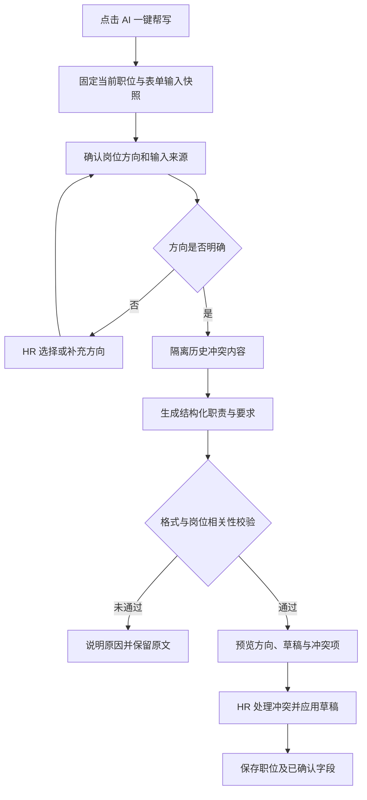

# 岗位职责与要求 AI 一键帮写：按职位生成的改动框架

- 日期：2026-10-21。
- 代码基线：v1.8.40，提交 `c4b943a`；行号用于定位，后续优先按函数名查找。
- 交付范围：现状分析、目标流程、接口与模块改动、历史数据处理和验收方案。本轮只新增本文，不修改应用代码、不打包发布。
- 已确认：默认按当前职位重新生成；原文优化另选；岗位方向不明确时先确认；冲突技能由 HR 确认处理；保留“预览 → 应用 → 保存”；失败保留原文；不自动修改历史测评。

## 1. 要解决的问题

“器械工程师”的帮写内容应围绕 HR 确认的器械岗位方向。没有相关依据时，不应出现 Vue3、TypeScript、前端开发或代码评审等职责。

职位名称是生成的主要依据。部门、行业、岗位方向和 HR 本次补充信息用于细化职责。历史职责与历史技能必须检查来源和相关性，不能直接当作当前职位的已确认要求。

“器械工程师”本身不能唯一确定机械结构、电子电气、研发或维修等方向。资料不足时先确认方向，不直接替 HR 决定为某一种器械岗位。本文不预设医疗器械业务、产品类型、证书或行业标准。

## 2. 当前代码中的确定问题

| 位置 | 当前行为 | 影响 |
| --- | --- | --- |
| [RecruitmentJobsView.vue](D:/HR/TalentLens-main/frontend/src/views/RecruitmentJobsView.vue:617)，新建职位 | `skillsInput` 实际预填 `Vue3, TypeScript, 性能优化`，并非占位提示 | 任意新职位都可能带入前端开发技能。 |
| 同文件 `generateJobDescription` 附近，647–669 行 | 无条件提交当前技能与旧 `currentText` | 职位改名后，旧资料仍进入生成输入。 |
| 同文件，637 行 | 使用 `core_criteria || required_skills` 读取技能 | 空数组在 JavaScript 中为真，可能遮住另一字段中的有效技能。 |
| 同文件，694、703 行 | 同一份技能同时写入 `required_skills` 和 `core_criteria` | 技能要求和核心能力被混写，污染可能持续保存。 |
| [job_description_ai.go](D:/HR/TalentLens-main/job_description_ai.go:44)，`GenerateJobDescriptionDraft` | 提示词要求描述冲突时参考现有描述中的明确事实 | 旧前端 JD 可能压过当前“器械工程师”标题。 |
| 同文件，53 行 | 所有传入技能都标作“已确认技能” | 历史遗留、AI 推定与 HR 确认无法区分。 |
| 同文件，65–69 行 | 只检查两个标题是否存在及长度上限 | 岗位方向错误的内容也可以通过。 |
| 前端同文件，656、672–676 行 | 异步结果写共享草稿，应用时不核对原请求职位 | A 职位的迟到结果可能进入 B 职位预览，并被应用。 |

可由代码复现的链路：

```text
新建职位预填 Vue3 等技能
  → 保存到非前端职位 / 修改职位名称后继续保留
  → 帮写无条件发送旧技能、旧职责
  → 提示词将它们视为可信事实
  → 结果只通过标题、长度检查
```

以上足以说明存在完整的污染路径。本轮未读取截图对应的生产职位记录或本次模型响应，因此不将截图的唯一成因断言为这条路径。

当前前后端的 JD 帮写失败都会返回/显示错误，没有自动填入本地 JD 模板。应保留这一行为。现有草稿预览、显式应用和单独保存机制也可以复用。

## 3. 产品流程

### 3.1 两种生成模式

| 模式 | 默认输入 | 旧资料处理 |
| --- | --- | --- |
| **按当前职位生成**，主按钮默认行为 | 当前名称、可确认的岗位方向、部门/行业、经验/学历、HR 本次补充约束 | 不直接把旧 JD 当事实输入；历史技能经检查、确认后才采用。 |
| **基于原文优化**，次级选项 | 当前职位资料与现有原文 | 先识别原文与当前岗位的冲突；冲突不能通过改写被悄悄保留。 |

两种模式共用岗位方向与结果校验。原文优化不意味着旧文优先于当前职位。

### 3.2 正常流程



### 3.3 界面调整

1. 新建职位的技能默认空白；职位名称和技能的提示文案采用中性说明，不把示例值写进表单。
2. 保留主按钮“AI 一键帮写”；“基于原文优化”放在同一入口的次级菜单。
3. 能从明确资料判断方向时直接生成。不能判断时，在生成前展示一次方向选择，允许填写其他方向；已确认方向可随职位保存。
4. 预览展示“本次采用的职位/方向”、职责、要求、待确认信息及疑似冲突技能。未解决的阻断项不能直接应用。
5. 冲突项逐项选择保留、删除或替换；原数据在保存前保持可恢复。若选择保留跨领域技能，须补充它在本岗位中的实际用途，再生成或校验受影响草稿。
6. “应用草稿”只更新当前编辑表单；“保存职位”才写入项目。取消预览或关闭窗口不写入职位。
7. 改名或修改关键输入后，旧草稿立即标为已失效。HR 重新触发帮写后再应用。

## 4. 输入依据和冲突规则

### 4.1 信息优先级

| 来源 | 处理规则 |
| --- | --- |
| 当前职位名称 | 主要依据；名称变更须重新检查岗位方向和旧资料。 |
| HR 本次明确确认的岗位方向、职责边界和技能用途 | 用于解释名称及细化职责；与名称明显冲突时先让 HR 澄清，不让模型自行选一方。 |
| 当前表单中的经验、学历等约束 | 原样遵守；不能自行提高，也不能将未知值写成硬门槛。 |
| 明确提供的行业、部门、产品背景 | 辅助细化；“研发中心”不足以推出“前端开发”。软件自身的技术栈不能成为岗位依据。 |
| 来源可追溯且与当前岗位相关的已确认技能 | 可以采用；跨领域要求须保留 HR 说明。 |
| 旧 JD、来源不明的历史技能 | 视为待核对材料；默认生成模式不将其作为已确认事实。 |
| AI 推导的职责、技能建议 | 仅是草稿建议；可由 HR 修改，不自动成为红线或已确认岗位标准。 |

旧 JD 和补充文本是待处理内容，不能作为改变系统生成规则的指令执行。

### 4.2 岗位方向识别

- 使用可维护、带版本的职业类别和别名映射，按完整语义匹配；不能因为名称包含“工程师”“研发”就套软件开发模板。
- 岗位名称明确时复用对应方向；方向由 HR 确认后在本次生成中固定。
- 如需 AI 辅助识别，只输出候选方向和依据；低置信或多个合理方向仍交 HR 确认，不先生成一篇可能错岗的 JD。
- 找不到合适分类时允许 HR 用文字说明职责方向，不强行归入软件类或任意通用模板。
- 分类表是产品维护资料，不宣称为未经核实的官方职业标准。

### 4.3 冲突识别

识别对象包括岗位方向、主要工作产出、工具用途及要求来源。不能只建立“器械岗位禁用 Vue3”的关键词黑名单：器械配套软件岗位可能确有 Web 界面开发要求。

例如，只有“器械工程师、研发中心”而旧技能为 Vue3/TypeScript，应列为疑似冲突并排除其默认生成影响；若 HR 明确说明负责器械配套 Web 界面，相关技能可以在确认后采用。

历史记录中出现默认技能组合只能作为疑似污染线索，不能据此批量删除真实的前端岗位要求。

## 5. 后端模块与接口框架

下列名称是拟议接口和模块边界，不代表当前已经实现。

| 模块 | 职责 |
| --- | --- |
| `normalizeJobDraftFacts` | 规范化输入，区分当前表单、HR 确认、历史未知来源与 AI 建议。 |
| `resolveJobDirection` | 根据名称和明确背景确定方向，必要时返回待确认选项。 |
| `detectJobContextConflicts` | 识别旧资料与当前方向的冲突，形成待处理清单，不修改项目。 |
| `buildJobDescriptionPrompt` | 按生成模式和来源优先级组织提示词，移除“旧文优先”的规则。 |
| `validateJobDescriptionDraft` | 检查结构、方向、技能用途及无依据门槛，返回错误或警告。 |
| `renderJobDescription` | 将已验证的职责和要求条目统一排版为编辑框文本。 |

保留 `GenerateJobDescriptionDraft` 为生成入口，改用有类型的请求/响应契约；同步更新 Wails bindings，移除前端 `any` 调用。生成服务不直接保存职位。

### 5.1 请求与结果至少包含什么

| 契约 | 必要内容 |
| --- | --- |
| 请求上下文 | 项目 ID 或新建表单实例 ID、请求 ID、表单修订号、生成模式。 |
| 岗位事实 | 当前名称、方向及确认状态、已提供的行业/部门、经验/学历、HR 本次补充说明。行业未提供时留空。 |
| 技能来源 | 技能名称、来源、确认状态；旧数据无来源时标 `legacy_unknown`，不能补写为已确认。 |
| 原文 | 只在原文优化模式中用于改写；默认起草模式不把未经确认的旧文发给正文生成步骤。 |
| 后端响应 | 原请求标识、后端计算的输入摘要、策略版本、采用方向、结构化职责/要求、输入依据、冲突项和待确认信息。 |
| 响应状态 | `needs_direction`、`needs_confirmation`、`ready`；配置/网络/输出无效等失败返回明确错误，不伪装为成功草稿。 |

摘要应覆盖生成相关输入、模式和策略版本，而非只有职位名称。HR 明确保留的跨领域要求也必须进入摘要和校验依据。

### 5.2 提示词的关键规则

1. 按当前职位和已确认方向生成；先定义岗位主要工作产出，再围绕产出写职责与要求。
2. 只将明确确认的资料称为事实；AI 补充的合理要求是草稿建议。
3. 不沿用与岗位无关的旧工具、旧职责或示例技术栈；不依照软件自身的前后端技术生成招聘要求。
4. 不编造公司产品、业务、待遇、证书或学历/经验门槛；缺少的信息列为待确认，不硬凑。
5. 每个条目说明与岗位方向或输入事实的对应关系，供校验和预览使用；不得用模型自报“相关”代替实际检查。
6. 输出精简的结构化条目，由程序渲染“岗位职责”“任职要求”；保留现有总长度限制并校验空条目、重复项和字段类型。

正常生成优先一次模型调用完成。输入检查、摘要、结构校验和已知冲突检测在本机执行；没有充分把握的语义相关性不能仅靠局部规则保证，交 HR 确认。首版不默认再调用一个模型做全文打分，也不做无限自动重试。

## 6. 校验、失败与异步保护

### 6.1 生成校验

| 检查项 | 处理 |
| --- | --- |
| 职位名为空、未确认的歧义方向 | 生成前提示补充，不发正文生成请求。 |
| 未经确认的旧技能进入“已确认”输入 | 阻断请求构建，返回来源/冲突信息。 |
| 缺职责/要求、字段类型错误、空条目、超长 | 不允许应用；保留旧文，说明结构错误。 |
| 明显错岗职责，例如结构研发变前端开发 | 阻断或转待确认，不仅检查两个标题。 |
| 跨领域技能有 HR 明确用途 | 按实际职责校验，不因关键词直接拒绝。 |
| 新增未提供的硬门槛或公司事实 | 移入待确认草稿或拒绝结果，不能直接成为保存值。 |
| 网络、模型配置或模型响应失败 | 显示真实原因，原文不变，由 HR 手动重试；不自动填通用文案。 |

### 6.2 防止串写

生成前固定 `formInstanceID + projectID + formRevision + requestID` 和输入快照。返回时与当前活动表单核对；点击应用时再核对一次。

- 关闭窗口、切换职位、修改名称/方向/技能等生成输入，都会使旧草稿失效。
- 旧请求即使无法真正取消，也必须丢弃迟到结果，不能写入新预览。
- 多次点击时仅最新有效请求可更新草稿；关闭旧请求的 loading 状态也须核对请求 ID。
- 保存时检查项目是否已被其他窗口修改；发生冲突先显示差异，不能用旧表单覆盖较新的职位配置。

## 7. 历史技能修复与下游版本

### 7.1 历史技能

1. 新建职位立即停止预填 Vue3 等示例值。
2. 编辑已有职位时同时读取 `required_skills` 与 `core_criteria` 并保留来源，修复空数组短路问题；展示可合并去重，保存不能无条件把同一数组写到两个不同含义的字段。
3. 无来源旧数据标为待核对；发现与当前方向冲突时提示，不自动删除，也不当作确认技能继续生成。
4. HR 应用草稿时的删除/替换选择先进入表单；保存时只更新已明确确认的字段，记录变更前后值和确认来源。
5. 不在后台扫描后自动改写全部 JD，不对旧职位批量调用模型。

### 7.2 雷达、红线与加分项

[app.go](D:/HR/TalentLens-main/app.go:4398) 中的 `EnsureProjectJobMetrics` 当前按指标数量判断是否复用，并可能继续参考旧 JD；它缺少对当前职位适配性和来源版本的核验。因此修正帮写还须防止旧指标继续影响后续分析。

- 保存名称、方向、JD 或已确认技能变化时，比较规范化来源摘要；有实质变化则标记岗位画像/规则建议待校准，不能因已有三项技能就直接认定可复用。
- 形成新岗位画像时使用已保存且来源明确的资料。打开草稿预览或取消编辑，不触发雷达重建与收费分析。
- 红线、加分项保持 HR 审批；AI 草稿中的任职要求不能自动转为淘汰条件。
- 历史测评保留原岗位资料与指标口径。新口径不得静默覆盖历史分数、坐标或把不同版本直接混排。
- 若完整版本机制尚未落地，至少显示“岗位资料已变化，指标待校准”，停止静默复用疑似污染指标；不能先把旧轴换名后继续展示旧分数。

固定画像、证据与评分的完整机制沿用[岗位雷达规范化方案](D:/HR/TalentLens-main/docs/job-radar-standardization.md)。该文属于设计方案；实施时需核对落地情况，不能假定当前版本已经具备其中全部能力。

## 8. 代码改动清单与顺序

| 阶段 | 位置 | 改动与完成标准 |
| --- | --- | --- |
| A：阻断污染 | `frontend/src/views/RecruitmentJobsView.vue` | 新建技能留空；区分模式；改名提示旧资料；加入表单实例/请求校验；沿用预览、应用、保存。 |
| A：纠正生成 | `job_description_ai.go` | 调整依据优先级；引入方向与来源；隔离冲突；结构化生成和结果校验；明确错误。 |
| A：同步契约 | `frontend/wailsjs/go/main/App.js`、`App.d.ts`、`models.ts` 及前端调用 | 通过 Wails 生成绑定并进行类型检查，前后端同版交付，不手工绕过类型。 |
| B：保存与迁移 | `useProjectStore.ts`、`app.go` 的项目更新/保存路径 | 区分技能字段；保留未知来源；保存方向、策略/输入摘要、确认记录；增加更新冲突检测。 |
| B：下游失效 | `EnsureProjectJobMetrics`、画像/规则建议入口及项目持久化 | 以岗位来源版本判断复用；资料改变时提示校准；不自动覆盖历史评估。 |
| C：回归 | `job_description_ai_test.go`；前端可独立测试的表单/草稿状态模块 | 补输入污染、方向校验、跨职位竞态和保存边界测试；联合验收。 |

优先完成 A，让错误的默认技能不再进入新请求；B 解决已保存的数据及后续分析延续污染的问题。不能仅修改提示词就宣布问题全部解决。

## 9. 验收用例

| 场景 | 必须满足 |
| --- | --- |
| 新建“器械工程师”，未填技能 | 请求没有默认 Vue3/TypeScript；方向不明确时先确认，正文生成不提前启动。 |
| 确认为“机械结构研发方向” | 草稿围绕该方向的工作产出；无依据的前端开发条目被拦截。此例仅用于测试，不是该名称的默认定义。 |
| “器械工程师”带旧 Vue3 技能和前端 JD | 默认模式隔离旧文、提示冲突；HR 确认前不把旧技能标为已确认，原记录不被自动删除。 |
| 原文优化模式含错岗内容 | 同样提示冲突，不因为选择优化而让旧文压过当前职位。 |
| HR 明确选择器械配套软件界面职责并确认 Vue3 | 可以生成相关 Web 职责；不被器械/Vue3 关键词黑名单误伤。 |
| 真实“Vue 前端工程师” | 可以生成 Vue3/TypeScript 要求，说明规则按相关性工作而非全局禁词。 |
| 空 `core_criteria`、非空 `required_skills` | 不因空数组短路丢失技能；来源和字段含义保留。 |
| 清空技能后保存 | 对应字段确实清空，不回填示例；未编辑的其他配置不丢失。 |
| 模型返回完整双标题但内容错岗 | 不能仅因格式合格就成为可应用草稿。 |
| AI 失败或 HR 取消 | 原 JD 和已保存职位不变，不出现伪装成功的通用文案。 |
| A 生成中切换 B；或生成后改名/改技能 | A 的迟到结果不进入 B，失效草稿不能应用。 |
| 应用草稿但未保存 | 仅改变当前表单；重新打开仍为原保存内容。 |
| 保存修正后的职位 | 下游识别岗位来源变化；历史测评不自动重算、改分或混用新雷达。 |
| 同时编辑同一职位 | 保存检测版本冲突，HR 能查看差异，较新配置不被静默覆盖。 |

现有后端测试只覆盖模型未配置和双标题草稿返回，前端暂无该视图的自动化测试。实施阶段优先用固定输入、模拟模型响应和可控 Promise 测试上述边界；再用获准的脱敏岗位样例做少量人工质量验收，避免为了回归反复消耗生产模型额度。

## 10. 完成判定

当“新建无默认污染、改名会检查旧资料、生成按当前岗位、方向歧义可确认、错岗草稿不可直接应用、历史变更可追溯、异步不串写、历史测评不被静默修改”均通过验收后，才进入后续打包发布流程。

本文提出的语义检查不能保证 AI 文案百分之百准确。HR 预览确认仍是保存前的必要环节；规则的作用是阻断已知污染路径、暴露疑点并提供可验证的修改依据。
