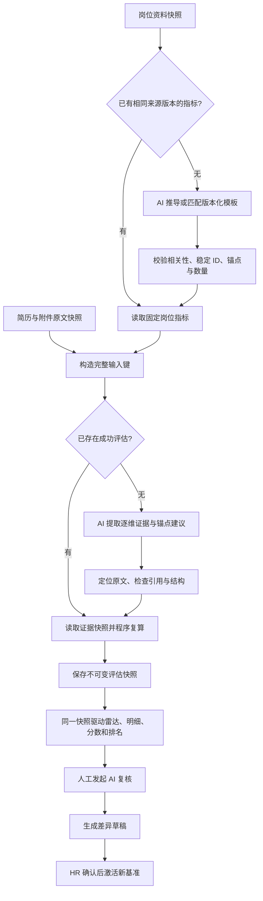

# 岗位统一技能指标雷达：现状分析与规范化实施方案

- 日期：2026-10-20。
- 代码基线：v1.8.29，提交 `6cd5511f5cfecdfd2f2bd5df26aa5400318f7e7e`。
- 本次交付：设计文档与专用 Skill 源文件；本文描述的目标机制需要后续开发接入，不能视为当前版本已经具备。
- 规范入口：[job-radar-standardizer/SKILL.md](../skills/job-radar-standardizer/SKILL.md)。
- 分析与评分的权威规则：[分析契约](../skills/job-radar-standardizer/references/analysis-contract.md)。本文负责解释现状、改造位置、实施顺序与验收；具体字段、公式和边界以分析契约为准。

## 1. 已确认的目标

| 决策 | 目标行为 |
| --- | --- |
| HR 未填技能 | 根据岗位资料生成统一指标并自动启用，标注 AI 推定；相同岗位版本下的所有候选人共用这套指标。 |
| 只有岗位名称 | 优先匹配有版本的职业技能模板继续分析，显示资料不足、待 HR 校准；推定技能不自动成为淘汰红线。 |
| 雷达与分数 | 雷达与岗位依据分使用同一组指标、证据与权重。本文沿用代码中的名称“岗位证据分”；两者指同一项产品分数。 |
| 指标数量与权重 | 优先 5–6 个相关维度，最多 8 个，不为数量拼凑维度；默认等权，后续权重调整生成新版本。 |
| 未写明的技能 | 标为证据不足，和有依据的低等级区分。 |
| 排名门槛 | 已知维度的权重覆盖率达到 80% 后，按已知维度计算岗位证据分并参与排名；不足时进入待核实组。 |
| 相同输入再次请求 | 自动复用已验证结果；相同证据快照由程序复算，结构化结果和分数保持一致。 |
| 重新分析入口 | 移除单条与批量“重新分析”，保留失败重试和人工发起的 AI 复核。 |
| AI 复核 | 新结果先成为差异草稿，HR 确认后启用。总分变化超过 3 分，或任一维度变化至少 2 级，标记显著变化并说明证据。 |

稳定性的重点是固定标尺、固定输入和程序计算。低温度提示词只能降低模型波动；缓存命中的完全一致与重新调用模型的语义稳定性，是两种不同的验收目标。

## 2. 当前实现：已有自动补全，但尚未统一整个链路

以下行号对应上述代码基线，后续定位优先使用函数名。

| 当前路径 | 已有行为 | 与目标的差距 |
| --- | --- | --- |
| `app.go:4060`，`EnsureProjectJobMetrics` | `RequiredSkills` 与 `CoreCriteria` 合计去重不足 3 项时，调用 AI；无模型或失败时使用岗位标题模板，追加保存到项目。 | 没有不可变的指标版本，也不检查岗位名称/JD 后续是否变化；已有 3 项即跳过，不能代表指标已经合格。 |
| `app.go:4110`，指标生成提示词 | 输入岗位标题和截取的岗位职责，未输入候选人。 | JD 按约 600 字节截取，可能截断中文；没有把已有技能作为必须保留的约束。返回校验主要是数组项数，缺少空项、重复、相关性和锚点评分规则校验。 |
| `app.go:2885`、`HomeView.vue:1131`、`:2376` | 每份分析前、打开项目页面时都可能触发自动生成。 | 缺少岗位级并发创建保护与持久化版本约束，多份分析可能各自生成不同指标并互相覆盖；页面读取也带有隐式写入。 |
| `app.go:1159`，`saveProject` | 将项目写入 JSON。 | 写入错误未完整向调用方传播，生成成功日志不能证明指标已经可靠保存。 |
| `HomeView.vue:1150`，`unifiedJobMetrics` | 雷达使用技能与核心能力的并集；不足时前端临时补通用维度。 | 前端坐标可能不是后端保存的坐标，没有形成唯一数据源。 |
| `HomeView.vue:1177` | 优先匹配 `experienceCompetencies`，再匹配 `coreCriterionChecks`，并允许子串匹配。 | 补充履历能力可能覆盖实际计分项；一条历史能力可能命中多个不同轴。缺失项被画成 0，混淆历史未分析、证据缺失与真实低等级。 |
| `HomeView.vue:1219` | 图只取前 8 项，明细展示全部。 | 图、明细、分数可能对应不同数量的维度。 |
| `resume_competencies.go:142`、`app.go:3659` | 有 `CoreCriteria` 时主要按它评分，否则按 `RequiredSkills`；按精确名称对齐并核对原文。 | 与前端并集雷达不同。AI 自动补入核心能力后，原技能可能不再进入后台评分。 |
| `app.go:3193`、`:3550`、`:3665` | 提示词包含分项加权公式；最终分又根据等级均值或暂估分计算。 | 模型提示、雷达与程序分数缺少一个共同的评分契约，无法稳定解释每一分的来源。 |
| `app.go:937`、`:2824`、`:2949` | 重分析重新提取文件并重新调用模型，可能还有补全/格式修复调用；最终总分限定在首次分数附近。 | 没有完整输入键与结果复用；初始分 ±5 的限幅不约束证据、轴等级或结论，也可能掩盖真实修正。 |
| `recruitment_store.go:439` | 当前评测数据可 UPSERT 覆盖。 | 缺少完整的单次评估快照、复核候选结果与基准激活记录，难以复现历史。 |

已有价值需要保留：岗位级自动推导入口、候选人分析前的准备步骤、原文引用校验、统一候选人/项目关联，以及失败时保留已有主要分析的行为。改造应收拢这些能力，消除重复规则。

## 3. 目标流程

### 3.1 岗位标尺先于候选人分析

将 `EnsureProjectJobMetrics` 改造成“取得或创建岗位雷达画像”的服务。生成阶段只接受岗位信息，不能读取候选人简历、旧候选人得分或候选人排名。HR 已填技能是已知岗位输入，应保留其事实含义；有重叠的概念在形成版本前合并，保存来源对应关系。

画像包含稳定维度 ID、名称、固定顺序、权重和逐级证据锚点。标题或别名用于展示与录入映射；评估结果按 ID 关联，不再用包含关系猜测。

模板是经过维护的产品技能模板，应记录模板 ID、版本和适用范围，不能仅凭一段通用文案宣称为行业权威标准。例如“测试开发工程师”须先识别测试自动化/质量工程语义，不能因为标题含“开发”就套入通用后端画像。

自动生成的画像可立即服务分析，但应显示推定来源、采用的岗位资料与可编辑入口。岗位资料或评分规则变化产生新版本，已经完成的分析保留原版本。

### 3.2 先保存输入，再调用模型

开始分析时保存简历、附件、岗位画像、分析基准日期、规则与模型配置版本。引用位置相对于固定文本快照，不依赖下一次重新解析的结果。

基准日期属于评估上下文。相同上下文下，“至今”的年限计算不随打开页面的日期而变化；需要新日期或新材料时建立新上下文/材料版本。

完整输入键、缓存命中与失败重试的精确定义见分析契约。缓存命中不调用模型，也不将已有结论清空为待分析。只有新输入或人工 AI 复核才产生新的模型结果。

### 3.3 AI 负责语义证据，程序负责验证与分数

AI 逐个维度提取原文引用、项目职责、交付范围与锚点满足情况，输出建议等级。程序核对维度 ID、引用位置、证据状态、锚点条件，并从已支持的等级计算得分。AI 返回的总分不作为正式计分输入。

逐字引用检查只能证明简历里存在这段说法，不能证明候选人确实掌握技能或履历完全真实。界面应把“原文可定位”和“HR 已核实”作为不同状态保存。

语义提取仍存在模型不确定性。因此，程序能保证相同已验证证据快照重复计算完全一致；强制获取新语义证据时，应通过差异复核处理变化，不能承诺所有外部模型每次输出相同。

### 3.4 单一评估快照驱动界面

后端返回完整的画像版本与逐维结果。前端直接展示稳定 ID 对应的轴、证据和分数，不再追加通用轴、使用子串匹配或只截取一部分轴。

未知项显示“证据不足”，不画成真实的 0 级点。图例、悬浮提示和明细共同标识未知；材料不足或有效维度少于 3 时展示说明和明细，结束加载状态。

正式排名只混排相同岗位画像与评分口径下、覆盖率达到 80% 的记录。排名显示岗位证据分与覆盖率；未知项较多的人不会因缺项被隐藏在一个看似完整的分数中。按已知项归一化会存在缺项偏差，这是本次选择的产品取舍，需保留覆盖率及全维度上下界供 HR 判断。

### 3.5 取消重新分析，保留明确的更新路径

| 触发 | 处理 |
| --- | --- |
| 单条/批量“重新分析” | 移除菜单、卡片和详情页入口，以及仅服务这些入口的状态文案。 |
| 失败重试 | 重试相同输入的未完成任务，保留原文和故障信息；已有同键成功结果时直接复用。 |
| 新简历或新增附件 | 保存新材料版本，按新输入键建立评估；旧结果仍可追溯。 |
| 岗位要求修改 | 创建新画像版本；旧评估标注版本差异，不能被前端强行重排为新坐标。 |
| 人工 AI 复核 | 使用固定的岗位画像与原文上下文重新提取证据，先保存差异草稿；HR 确认后才变更当前基准。 |

复核不向模型灌入“请接近原分数”的锚定要求，也不对新分数做 ±5 截断。旧分数可以供差异页面比较，不作为模型证据。

## 4. 数据与接口改造

### 建议持久化实体

| 实体 | 必要职责 |
| --- | --- |
| `job_radar_profiles` | 保存不可变岗位画像、来源哈希、模板/策略版本、激活状态与创建来源。 |
| `radar_source_snapshots` | 保存本次原文清单与规范化文本哈希，明确简历/附件来源。 |
| `radar_evaluations` | 保存完整输入键、画像快照引用、证据结果、覆盖率、程序分数、状态及父评估 ID。 |
| `radar_reviews` 或等价事件表 | 保存复核差异、阈值告警、HR 激活/拒绝和理由。 |

数据库唯一约束和事务保证同一岗位来源版本不会激活多套画像，同一输入键只有一个当前成功基准。进程内锁用于减少重复调用，数据库约束负责防止多个应用进程同时写入造成覆盖。

画像保存成功后才能分发给候选人分析。继续使用项目 JSON 时，也必须传播写入错误并采用原子替换；不能先向前端报告成功，再忽略落盘错误。

### 建议服务边界

- `GetOrCreateJobRadarProfile`：岗位来源快照到固定画像；内部处理单次生成、验证、模板回退和事务提交。
- `GetOrEvaluateRadar`：完整输入快照到成功评估；先查同键结果，再做证据提取与程序评分。
- `RetryFailedRadarEvaluation`：只重试失败/中断任务，复用已固定的画像和输入。
- `CreateRadarReview`：产生新证据候选版本和差异，不修改已激活结果。
- `ActivateRadarReview`：记录 HR 确认并切换当前基准，保留旧版本。

命名可按实现调整，职责、版本边界和状态转换应保留。不能将“取画像”同时做成按候选人自由扩展指标的接口。

## 5. 实施顺序与代码落点

| 阶段 | 改造位置 | 完成条件 |
| --- | --- | --- |
| A：固定岗位画像 | `app.go` 的 `EnsureProjectJobMetrics`；岗位配置保存与 `recruitment_store.go` 迁移 | 空技能可生成并可靠保存一套画像；并发请求拿到同一版本；修改岗位产生新版本。 |
| B：统一证据与评分 | `buildAnalysisPrompt`、`resume_competencies.go`、`applyJobDecision`、`scoreCandidate` | 主分析/补全使用同一维度 ID 与锚点；未知和低等级分离；程序公式成为唯一正式分数来源。 |
| C：结果复用与历史 | `AnalyzeResume`、`recruitment_analysis.go`、评估持久化 | 同键成功结果不再调用模型；失败不覆盖旧成功基准；保存可复现快照。 |
| D：界面统一 | `HomeView.vue`、`useProjectStore.ts`、`useResumeStore.ts` 与所有重分析入口 | 轴、明细、分数、覆盖率来自同一评估 ID；移除前端补轴、模糊匹配、截断和重新分析菜单。 |
| E：复核与迁移 | AI 复核差异界面、旧评估兼容与排名查询 | 草稿结果经过 HR 激活；历史标尺可追溯；不同版本不会静默混排。 |

建议将岗位画像生成、证据定位和纯评分计算收敛成可独立调用的模块。提示词、字段和公式不要继续分散在多个分析/补全入口里各自维护。

## 6. 专用 Skill 如何真正参与每次分析

当前应用没有读取 `SKILL.md` 的运行时路径。仓库中的 Skill 用于让开发或分析代理遵循同一契约；它本身不会自动改变已安装的 TalentLens。

运行时接入应包含三个层次：

1. 把分析契约中的相关提示词/输出要求作为受版本控制的应用资源打包，岗位生成与证据提取分别只加载自己所需的规则；每次请求保存 `policy_version` 与资源摘要。
2. 用程序实现同一契约的结构、引用、评分、缓存与状态校验。模型只返回数据，不能通过输出新指令修改权重、阈值或证据规则。
3. 发布前以画像、证据和评分夹具验证策略版本。改变提示词、规范化规则或模型配置时，明确创建新管线版本，不在旧评估上偷偷替换规则。

仓库 Skill 与运行时资源引用同一分析契约作为维护依据；构建过程应检测资源摘要和声明版本的一致性。加载 Markdown 不能替代数据库版本约束和程序计算。

## 7. 历史数据迁移与上线

1. 备份当前岗位配置、简历与评估。为旧数据标注 `legacy_unversioned`，保留原始结果和已知来源，不把历史自动生成项误标为 HR 已确认。
2. 为每个岗位建立新画像版本。优先使用已有岗位技能/JD；合并或去重需留下旧名称到新 ID 的映射记录。
3. 历史结果缺少画像快照时，展示原有明细并标注“旧口径”；不使用当前画像补 0，也不自动将补充履历能力当作新维度证据。
4. 只有引用仍可验证、且维度映射经过明确确认的记录，才能在不新增 AI 调用的情况下建立新证据快照。其余历史记录保持旧口径，供 HR 主动发起 AI 复核。
5. 新画像和新评估先在独立版本启用；回退切换活动版本指针，保留已生成记录。上线不自动对全库发起收费模型调用。

## 8. 验收清单

| 场景 | 可观察的验收结果 |
| --- | --- |
| 空技能、完整 JD | 自动生成相关画像，所有候选人引用同一画像哈希；没有候选人信息进入生成请求。 |
| 只有标题 | 使用有版本的匹配模板并显示推定来源；无法可靠匹配时继续整理履历、提示补充岗位信息，不伪造完整岗位画像。 |
| 已填部分技能 | 明确保留其岗位含义；生成后图、明细和计分维度完全相同。 |
| 同岗并发 20 个分析 | 同一个来源版本最多提交一套活动画像，不发生覆盖；失败的保存不能让评估引用不存在的画像。 |
| 同一证据快照复算 100 次 | 维度 ID、顺序、证据状态、等级、覆盖率和程序分数完全一致。 |
| 同一输入键重复请求 | 成功结果复用，新增模型调用数为 0；不存在重新清空旧成功结果的中间状态。 |
| 未知与低分 | 没写技能的维度为未知；明确低等级有证据；覆盖率和分数按契约计算，未知不被画成真实零分。 |
| 覆盖率边界 | 79.99% 不进入正式排名，80% 可以；按未四舍五入的权重判断边界。 |
| 评分样例 | 契约中的等权、非等权、全未知和显式低等级样例均得到规定结果。 |
| 岗位修改 | 新画像不改变旧雷达坐标；不同口径有版本提示，不静默混排。 |
| AI 复核 | 任何草稿均不自动替换；超过 3 分或跨 2 级告警。证据集合变化时单列，不把覆盖率变化简单解释为能力升降。 |
| 保存/接口/模型失败 | 已成功基准和原文保留；错误状态可重试；没有伪造分数或无尽“正在生成”。 |
| 界面入口 | 卡片、批量菜单、详情和异常提示中的重新分析入口均移除；失败重试与 AI 复核去向明确。 |

外部模型的稳定性另做离线回归：选择获准使用的脱敏、覆盖不同岗位和材料完整度的固定夹具，在相同画像、基准日期和管线版本下重复提取。统计逐轴等级、证据集合、已知项覆盖率与分数差异；以“至少 95% 的可比分数变化不超过 3 分、至少 95% 的可比维度变化小于 2 级”作为初始调优目标，同时要求所有被接受引用可定位。此为待实测目标，不是已经达到的保证；不达标时调整锚点/提取策略或保留人工复核，不能增加截分逻辑使报表看起来稳定。

本轮文档验收：文件之间的链接有效、Skill frontmatter 合法、规则和公式互相一致，并用独立案例检查未知值、覆盖率与复核分支。生产功能的上述验收留待实现阶段执行。
