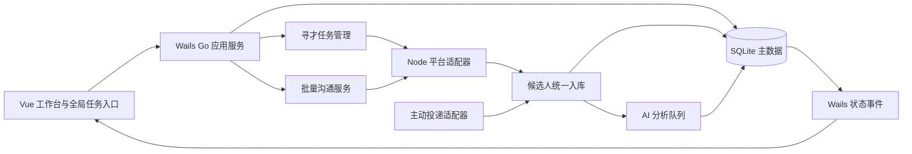

# TalentLens 招聘工作台与全渠道寻才实施框架

> 目标代码目录：`D:\HR\TalentLens-main`。本文件供后续实施模型逐阶段执行，业务决策来自 2026-10-13 的需求访谈。视觉参考为 `build/bin/recruitment-system.html`，业务术语与人工核验规则以 `CONTEXT.md` 为准。实施时先读取仓库现状及未提交改动，再修改代码。

## 1. 最终交付

把现有招聘项目、四平台寻才和 AI 简历评估整合为一个使用真实数据的招聘工作台：

1. 检索窗口可缩到工作台右侧任务入口。检索继续运行，每位候选人成功入库后立即进入分析队列；HR 可同时查看已抓取、分析中和已完成的简历。完成、失败、验证待处理均有明确提醒。
2. 岗位模板提供针对性的红线、核心能力与加分项；AI 可补充建议，HR 确认后才对项目生效。AI 只给证据线索，红线结论仍由 HR 核实。
3. 用统一候选人档案组织人才库，以岗位和项目视图展示不同评测与跟进记录，并支持可信去重。
4. 提供招聘跟进、沟通记录、负责人、下一步日期和本地面试日程。
5. 每个项目的前十人可生成逐人定制的招呼语，HR 逐条预览编辑、一次确认批量发送，逐人记录真实结果。
6. 主动投递先从 51job 一键增量导入；接口支持以后扩展 BOSS、智联和猎聘。根据平台职位 ID 归档，无法确认岗位时进入“待分配”。
7. 按参考 HTML 重设计概览、职位、人才库、面试和跟进五个页面，保留“透景 / Tellgen”品牌、现有 AI 招聘助理与设置入口。所有业务数字来自本地数据，不能复制设计稿中的示例数据或假成功提示。

## 2. 当前代码的起点

| 领域 | 已有基础 | 需要改造的关键点 |
| --- | --- | --- |
| 寻才 | `frontend/src/components/BossSearchDialog.vue`、`app.go` 的 `StartSearchWithPolicy`、`scripts/multi_platform_agent.js`；四平台共享配额，候选人逐条持久化并发出事件 | 弹窗状态局部保存，关闭会停止检索；自动分析在整轮检索结束后才启动。改为全局可恢复的任务及入库即排队 |
| 分析 | `StartProjectAnalysis`、批量分析进度事件、`useResumeStore.ts` | 按项目候选人逐条排队、去重、限并发；检索与分析互不阻塞 |
| 岗位规则 | `JobConfig`、`jobPresets.ts`、红线与加分项人工核验 | 模板覆盖不完整；增加建议来源、审批状态和规则版本，保留既有项目判断 |
| 项目与简历 | `Project.ResumeIDs`、`Resume.ProjectID`、`GetProjectRanking`；数据存于用户文档目录的 JSON 文件 | 现有单项目简历结构不足以支持一人关联多个项目，需迁移至 SQLite |
| 沟通 | 单人操作入口及 51job 职位、点数确认流程 | 批量操作需要稳定的平台候选人 ID、逐条状态与幂等校验；不能按姓名猜测目标 |
| 界面 | 已有 `AppSidebar.vue`、主题切换、项目列表及项目详情 | 参考 HTML 的五个视图仍是静态稿；需变成 Vue 页面和真实数据工作台 |

## 3. 不可破坏的业务规则

- **评测**：能力分与红线状态分别呈现；材料未写明时为“待核实”，不能当作不满足。确认过的加分项只在同一 5 分能力档中排序，不抬高能力分。沿用 `CONTEXT.md` 的证据与 HR 核验流程。
- **排名**：每个项目单独排名，只将已完成分析的人纳入“前十可联系候选”计算。已确认红线不满足者不进入发送名单；红线待核实者保留排名，但批量发送前必须由 HR 主动勾选。未分析、发送过、缺少明确平台目标的人需展示原因，不能静默跳过。
- **去重**：相同平台及平台候选人 ID，或经核实的同一联系方式，可自动关联至同一候选人。姓名、公司、经历相似只生成“疑似重复”提示，由 HR 合并。相同简历文件哈希只能证明文件重复，不能单独证明人相同。
- **沟通**：点击按钮、打开聊天窗口或脚本退出成功都不等于消息发送成功。只有平台可核对到对应候选人的新发送记录，才记为成功；结果不明时标记“待核查”，不得盲目重试。沿用 51job 的职位 ID、点数报价及发送前后核对流程。
- **真实数据**：设计稿里的候选人、数字、日程和“已通知”文案只是展示样例。工作台空数据时呈现空状态；预约面试仅保存在本地，不能声称已通知候选人或面试官。
- **历史数据**：旧 JSON 文件和附件在 SQLite 迁移成功且校验通过前保持原样；不能因为项目改名、规则更新或重复导入而覆盖原始简历、评测及人工核验记录。

## 4. 目标架构

**职责边界**：Go 管理任务生命周期、数据库事务、规则及沟通状态；Node 适配器只负责读取平台页面和执行经过确认的单项操作；Vue 展示数据库快照并订阅事件，不把弹窗组件当作任务状态的唯一来源。查询返回快照，事件只负责增量通知；重新进入页面时必须能从数据库恢复准确状态。

**任务并发**：保留四渠道共享总配额、关键词方案和缺额说明。一轮检索可以依次访问多个渠道，同时由独立、有限并发的 AI worker 分析已入库人选。首版同一时刻只运行一个平台检索任务；新检索须排队或明确提示，不得悄悄杀掉前一个任务。AI 队列可处理多个项目，但必须按项目的岗位配置快照评测。

**任务生命周期**：`queued → running → completed / partial / failed / stopped / interrupted`。运行中切换页面或缩小面板不改变任务状态。应用退出时保留已抓取结果；下次启动把未完成任务标为 `interrupted`，由 HR 手动继续。继续时继承任务参数并排除已收录的稳定平台身份；不能从头重复计数。

### 建议的 Wails 接口与事件契约

可按现有命名调整，但前后端需共同遵守稳定 ID、快照查询、增量事件三项约束：

| 操作 | 建议接口 | 返回或事件必须包含 |
| --- | --- | --- |
| 启动、停止、继续检索 | `StartSourcingTask`、`StopSourcingTask`、`ResumeSourcingTask`、`ListSourcingTasks` | `taskId`、`projectId`、状态、目标数、已入库数、各渠道进度及错误 |
| 查询人才与评测 | `ListCandidates`、`GetCandidateProfile`、`GetProjectRanking`、`RetryAnalysis` | `candidateId`、`projectId`、`resumeVersionId`、`evaluationId`、规则版本和分析状态 |
| 规则与投递 | `SuggestJobRules`、`ApproveJobRules`、`ImportApplications`、`AssignApplication` | 规则草稿/批准版本；`importRunId`、平台投递 ID、平台职位 ID 与分配结果 |
| 跟进与面试 | `UpdateCandidateStage`、`AddFollowUpEvent`、`UpsertInterview` | 项目候选人 ID、操作者、时间及保存结果 |
| 批量沟通 | `PreviewTopTenOutreach`、`ConfirmOutreachBatch`、`GetOutreachBatch` | `batchId`、每个 `itemId`、明确的平台目标、消息、费用确认、真实回执与逐项状态 |

事件建议为 `sourcing:updated`、`candidate:upserted`、`analysis:updated`、`application_import:updated`、`outreach:updated`。每条事件带稳定实体 ID、所属项目、时间或递增版本。组件可用事件刷新局部展示；重进页面、断线或重启时必须调用查询接口获取完整快照。

### 核心数据实体（建议表）

| 实体 | 必需字段与约束 | 用途 |
| --- | --- | --- |
| `projects`、`job_templates`、`job_rules` | 项目保存岗位配置快照；规则含类型、文本、来源、`draft/approved`、审批人时间和版本 | 区分模板建议、AI 建议及项目已生效规则 |
| `candidates` | 内部稳定 ID、展示资料、创建及更新时间 | 全局唯一档案，不保存项目专属评测结论 |
| `candidate_sources` | `candidate_id`、平台、平台候选人 ID、详情 URL、来源类型、首次及末次发现时间；`(platform, platform_candidate_id)` 在有 ID 时唯一 | 保留多平台身份及出处；平台 ID 不存在时不得用姓名填充 |
| `resume_versions` | 候选人 ID、来源、原文或附件路径、版本、内容哈希、获取时间 | 支持在线卡片、主动投递、完整附件和重新评测 |
| `project_candidates` | `(project_id, candidate_id)` 唯一、跟进阶段、负责人、下一步日期、关联来源 | 一人可关联多个项目，阶段按项目独立 |
| `evaluations`、`criterion_reviews` | 项目候选人、简历版本、规则版本、分析状态、能力分、原文证据、HR 决定 | 避免把旧项目评测或人工结论覆盖为新岗位结论 |
| `search_tasks`、`analysis_jobs` | 配置快照、进度、错误、状态、重试次数；分析任务按项目候选人及输入版本去重 | 支撑缩小、切页、重启和逐条分析 |
| `platform_job_mappings`、`applications`、`import_runs` | 平台职位 ID 对应项目；平台投递 ID 唯一；导入游标、归档状态和错误 | 一键增量抓取及“待分配”收件箱 |
| `outreach_batches`、`outreach_items` | 排名快照、接收目标、编辑后的消息、职位 ID、费用确认、逐项状态与平台回执 | 批量发送的审计与安全重试 |
| `follow_up_events`、`interviews` | 项目候选人、阶段变更、备注、操作时间；面试时间、方式、面试官、状态 | 跟进时间线、本地日程与待办 |

所有外部平台 ID、项目 ID 和内部候选人 ID 应使用不同字段。完整附件仍保存在用户数据目录，由数据库记录路径与哈希。敏感联系方式仅在确有授权且已核实的情况下用于去重；界面按现有权限范围展示。

### 迁移要求

1. 在当前用户数据目录旁建立带时间戳的原 JSON 备份清单；检测旧 `projects/*.json`、`resumes/*.json`、配置和附件路径。迁移过程可重复执行，记录 schema 版本。
2. 先导入项目与岗位快照，再导入简历及人工核验，再建立候选人与项目关联。旧记录缺稳定平台 ID 时分开导入并产生疑似重复提示，不按姓名直接合并。
3. 单个事务或分批可回滚事务写入 SQLite，按项目、简历、评测、附件引用计数并抽样校验关键字段。验证通过后再切换读取入口；失败则仍从原 JSON 读取，保留错误报告。
4. 历史项目规则保持原文、历史核验保持原结论；无法判定是否经 HR 审批的模板条目标记“待确认来源”，新 AI 建议一律为草稿。不要在迁移中重新调用 AI。

## 5. 端到端流程

### A. 四平台寻才与即时分析

1. HR 在项目内配置渠道、关键词、总目标人数、活跃度及分析选项；启动后创建持久化 `search_task`。
2. Node 按现有渠道策略逐条输出候选人；Go 核对项目、持久化来源与简历版本、去重后才增加“已抓取”计数，并立即创建分析任务。
3. 分析 worker 使用入库时的项目规则版本与简历版本，发布 `已抓取 → 待分析 → 分析中 → 已完成/失败` 状态。AI 未配置或调用失败时保留档案并显示可重试原因，不阻塞检索。
4. HR 点击“缩小”后在右侧常驻任务入口查看渠道进度、已抓取数、分析进度、错误及验证码待处理；项目人才列表实时更新，完成时显示应用内提醒与任务角标。
5. “停止”与“缩小”是不同操作。停止须保存当前结果；重新打开软件后只显示中断及“手动继续”。检索完成但仍有简历在分析时，分别展示两个进度，不提前宣称全任务完成。

### B. 岗位规则

模板库为不同岗位提供可编辑的红线、核心能力和加分建议；没有可核验硬性条件的岗位允许零条红线，不能为了数量编造。AI 补充建议输出结构化类型、岗位关联理由及可验证方式，默认 `draft`。HR 可逐条修改、删除、批准并保存为项目规则版本。批准后的新版本只作用于新评测；旧人选仅在 HR 主动选择“按新规则重评”后产生新评测版本。AI 的 `met/violated/unknown` 与原文证据仍需人工确认，且加分不改变能力分。

### C. 人才库与跟进

全局人才库按岗位、项目、来源、分析状态、红线状态、跟进阶段和负责人筛选。候选人详情保留来源、所有简历版本、各项目评测、人工核验、沟通及跟进时间线。跟进阶段：`新入库 → 待评估 → 待联系 → 沟通中 → 初面 → 复面 → Offer → 入职`，另有`暂缓`和`淘汰`。阶段移动记录操作者、时间、备注；负责人和下一步日期产生本地待办。跨项目移动不应改写另一项目的阶段。

### D. 主动投递

在岗位或人才库点击“一键抓取主动投递”，首版 51job 适配器仅获取当前企业账号可核实的新投递，输出统一字段：平台投递 ID、候选人 ID、平台职位 ID、投递时间、简历/附件、来源链接。以投递 ID 做增量幂等；平台职位 ID 映射到唯一项目时自动入库并排队分析，找不到或映射多项时进入“待分配”收件箱，HR 手动指定项目。展示本次新增、重复、待分配、失败数。其他三平台以后复用同一导入契约及验收用例。

### E. 前十名定制打招呼

每个项目按现有 5 分能力档规则形成排名快照：先比较能力分档，同档比较已确认加分项，再比较原始能力分，最后使用稳定时间及 ID 顺序。候选人分析未完成不进入前十；已确认红线不满足不进入发送名单；待核实者默认不勾选，HR 可主动纳入。少于十人则按实际人数显示。

“向前十打招呼”打开批次预览：逐人展示渠道、候选人、职位、红线状态、成本、证据片段和独立可编辑文案。AI 只能使用简历可核对的职业事实与岗位模板；没有可信事实时使用经 HR 认可的通用岗位招呼语。HR 一次确认后，系统逐人执行并显示 `待发送/发送中/成功/失败/待核查/需人工处理`，不因某人失败而把整批标成成功。相同项目、平台候选人、职位及沟通目的已有成功记录时阻止重复发送。

平台适配器必须报告“是否支持首次发送自定义文字”、职位选择和点数等能力。当前 51job 首次 Hi聊使用平台默认招呼语；若实际页面仍不能核实可发送逐人定制文字，该项留在批次中并标记“需人工处理”，不能用默认文案冒充定制发送，也不能在平台招呼语后自动补发重复消息。平台能力将来经验证后再开放自动发送。

## 6. 工作台页面设计

沿用参考 HTML 的侧栏、顶部搜索与操作区、Indigo/Violet 主色、Slate 中性色、卡片与圆角体系及明暗主题；浅色主色可从设计稿的 `#4F46E5`、背景 `#F5F6FB` 起步，深色背景参考 `#0B1020`。品牌名称和标识保持“透景 / Tellgen”。把参考 HTML 拆为 Vue 组件和主题变量，复用现有 Wails 窗口操作、路由、国际化与 Element Plus。页面及导航如下：

| 页面 | 真实数据与核心操作 |
| --- | --- |
| 招聘概览 | 在招项目、指定时间范围新增候选人、待办、面试、招聘漏斗、最近动态；卡片能跳转到筛选后的列表 |
| 职位管理 | 现有项目与岗位配置、模板规则审批、发布渠道及 51job 已有发布入口；职位与项目映射清楚可见 |
| 简历人才库 | 岗位/项目筛选、来源与状态筛选、列表/卡片、候选人详情、疑似重复、主动投递导入、项目排名及前十批量沟通 |
| 面试安排 | 创建、修改、取消及查看本地面试日程；展示候选人、项目、面试官、方式和时间；保存不代表对外通知 |
| 候选人跟进 | 按岗位/项目看板及列表视图，阶段移动、负责人、备注、沟通记录、下一步日期和待办 |

矩阵寻才页/面板要有配置区、四渠道配额与实时状态、逐条抓取流水、分析流水、日志与“缩小/停止/继续”。缩小后的任务入口固定在工作台右侧，点击可恢复详细面板。人才列表先显示“已抓取”卡片，分析完成后渐进补齐分数、证据和核验状态；失败项给出重试操作。空状态、加载状态、错误状态及深色主题都须设计，不出现静态假数据。原 AI 招聘助理、系统设置和项目深度评估能力仍可从新工作台到达。

## 7. 给实施模型的分阶段任务

每阶段只处理表中的交付，完成后提交“改动文件、接口/迁移说明、测试结果、剩余风险”。先阅读本文件、`CONTEXT.md`、相关现有代码及当前 `git status`，保留用户已有修改；不要用参考 HTML 的内联脚本或示例数据代替应用功能。

| 阶段 | 实施任务 | 完成条件 |
| --- | --- | --- |
| 0. 基线与契约 | 梳理旧 JSON、Wails API、平台事件、排名和 51job 沟通路径；确定 SQLite driver、数据库位置、schema 与迁移方案；画出真实路由/页面映射 | 形成可审查的 schema、迁移及事件契约；现有 Go/Node/前端构建基线可复现 |
| 1. 存储与迁移 | 实现 SQLite schema、repository、备份、旧数据导入、回滚与校验；适配现有项目/简历读取接口 | 旧项目数、简历数、评测与附件引用一致；重复迁移不重复数据；迁移失败可继续读取旧数据 |
| 2. 寻才和分析任务 | 将检索状态移出 `BossSearchDialog.vue`；持久化任务；逐条入库即排队分析；全局事件和右侧任务入口 | 检索未结束时已有候选人完成分析；缩小/切页不中断；重启后显示中断与手动继续 |
| 3. 岗位规则 | 补齐模板建议、AI 结构化补充、HR 审批、规则版本及按版本重评 | 未批准建议不影响排名/评测；旧人工核验完整保留；加分只在同档排序 |
| 4. 人才库与跟进 | 统一候选人、跨项目关联、可信去重、岗位视图、阶段看板、时间线、负责人、备注和待办 | 同一候选人在两个项目拥有独立分数与跟进；疑似同名不自动合并 |
| 5. 主动投递 | 实现统一导入契约、51job 适配器、职位 ID 映射、待分配箱、增量游标与导入统计 | 重复点击只新增新投递；已知职位自动归档；未知职位不猜测 |
| 6. 前十沟通 | 排名快照、逐人文案生成与编辑、批次确认、适配器能力检查、真实回执与防重复 | 每人收到不同且有依据的文案或明确通用文案；不支持定制的渠道标记人工处理；未知发送结果不自动重试 |
| 7. 完整工作台 | 按 HTML 参考实现五个真实数据页面、明暗主题、任务通知及导航，整合前面所有入口 | 五页无示例数据或虚假操作；关键流程可从工作台完成；浅色/深色与常用窗口宽度下可用 |

阶段 1 后优先保持现有 API 兼容；涉及旧函数签名调整时同时更新 Wails 生成绑定和调用方。平台页面选择器变化是独立适配器风险，应使用脱敏的页面 fixture 进行验证，而非以姓名或按钮点击作为成功依据。

## 8. 必须通过的验收场景

1. 四渠道检索正在运行时缩小面板、切换到人才库：新候选人实时出现并可在检索结束前完成 AI 评测；检索总配额不变。
2. 搜索中退出应用再启动：已入库的人仍在，任务显示“已中断”；手动继续只抓取新目标。
3. 两名同名候选人来自不同平台且无可信身份字段：保持两个档案并提示疑似重复；同一平台同一候选人 ID 重复导入只保留一个身份关联。
4. 同一人关联两个项目：有不同评分、红线核验、阶段、负责人和沟通历史，互不覆盖。
5. AI 建议一条新红线与加分项：审批前无效；HR 批准后仅新评测使用新版本；历史结果仍可查看。
6. 前十名单有红线不满足与待核实者：前者不能发送；后者只有 HR 明确勾选后进入预览；加分只在同 5 分档调整顺序。
7. 批次中十条文案可分别编辑；某人发送失败或结果不明时其他人的真实状态保留，重试前核对平台已有会话。
8. 51job 投递一键导入：已映射职位自动进入对应项目；未映射进入待分配；再次导入无重复。
9. 旧 JSON 数据迁移后核对数量与关键字段；模拟中途失败可回退且原文件未被修改。
10. 五个工作台页面所有计数、列表、日程与操作结果都来自真实数据；空库不显示参考 HTML 的候选人和数字，面试保存不显示“已通知”。

推荐验证命令：仓库根目录运行 `go test ./...`、`npm test`，前端目录运行 `npm run build`；新增的迁移、任务恢复、去重、规则版本、投递幂等和批次沟通行为需要各自的针对性测试。最后在 Wails 应用中走通上面的端到端场景，并核对深浅主题。

## 9. 可直接交给其他模型的总提示词

> 请在 `D:\HR\TalentLens-main` 按 `docs/recruitment-workbench-framework.md` 实施。先读 `CONTEXT.md`、参考 HTML、当前 `git status` 和相关代码；保留现有改动。每次只完成“分阶段任务”中的一个阶段，先确认其前置阶段的契约与数据已具备。实现真实 Go/Wails、Vue、Node 及 SQLite 连接，不复制 HTML 示例数据或假发送提示。完成后运行该阶段相关测试，报告改动文件、验收场景、迁移或平台风险，并标记下一阶段的接口依赖。
